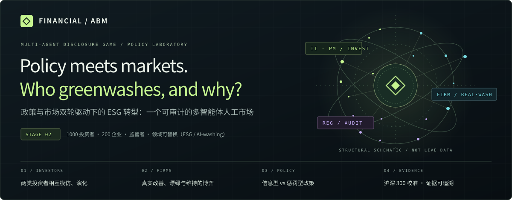

<p align="center">
  
</p>

<p align="center">
  <a href="https://github.com/kanzaler123/financial-ABM/actions/workflows/tests.yml"></a>
  <a href="https://github.com/kanzaler123/financial-ABM/actions/workflows/showcase.yml"></a>
</p>

<p align="center">
  <b>Why do firms greenwash, and which policies actually drive real ESG transition?</b><br>
  Multi-agent artificial market · evolving investor types · firm disclosure game · policy experiments · auditable evidence
</p>

<p align="center"><a href="README.md"><b>中文</b></a> · <a href="https://kanzaler123.github.io/financial-ABM/"><b>Live policy desk</b></a> · <a href="#stage-f-findings"><b>Stage F findings</b></a> · <a href="docs/README.md"><b>Docs index (Chinese)</b></a></p>

---

> [!NOTE]
> **Research in progress.** The stage F confirmatory experiment is complete; see [Stage F findings](#stage-f-findings). Its conclusions are conditional on the model's assumptions, and policy-effect magnitudes depend on an uncalibrated natural decay, so they are reported as a range. Other items carry an evidence label.

## The question

Most ESG research asks backward-looking correlation questions: do high-ESG firms earn more, or borrow more cheaply? Those methods struggle to explain **how** a transition happens, and they cannot compare policies that were never tried.

This project builds an artificial financial market in which heterogeneous investors and firms interact, learn and evolve, and then treats policy as a controlled variable:

> **Under joint pressure from policy and markets, how efficient is the ESG transition, and what path does it take?**

1. **Which policy works better?** Information policies (transparency) versus enforcement policies (fines), compared at equal expected penalties.
2. **How strong is the market's own engine?** Can impact investors drive a transition by “voting with their feet”? Do policies amplify or replace that force?
3. **Do large and small firms differ?** Is there an “ESG divide” in how fast norms spread by firm size?
4. **When does the market fall into a greenwashing trap?** Phase diagrams separating transition success, failure and greenwashing traps.

## Agents

| Agent | Count | Behaviour |
|---|---|---|
| **Profit-maximizing investors (PM)** | part of 1,000 investors | Mean–variance allocation; ESG has no utility value |
| **Impact investors (II)** | part of 1,000 investors | Utility includes a taste for *reported* ESG. Investors imitate the better-performing type each quarter, so the II share evolves |
| **Firms** | 200, in large / mid / small tiers | Each period: **real improvement** (costly, delayed), **greenwashing** (cheap, fast, may be audited) or **maintain**. NPV-rational or Q-learning modes |
| **Regulator** | 1 | Transparency, audit probability, fines and subsidies; policies can switch on any date |
| **Market maker and noise flow** | — | Multi-asset quasi order book with price impact, volatility-dependent depth, and daily cash and share conservation |

The disclosure game, a true attribute versus a reported attribute, is not specific to ESG. **A domain is a JSON file**; the core code contains no domain vocabulary, and a test enforces that. Bundled domains: [ESG](configs/domains/esg.json), [AI-washing](configs/domains/ai_washing.json), [WBA social](configs/domains/wba_social_2023.json).

**Game-theoretic benchmarks.** Each layer maps to a classic game: firm vs regulator (inspection game), firm vs investors (signaling: pooling vs separating), investor population (evolutionary game and replicator dynamics), regulator as a Stackelberg leader. The simulation tests whether boundedly rational, learning agents reach these equilibria, and where they get stuck.

## Stage F findings

> Confirmatory experiment (2026-10-15): 59 scenarios × 30 paired seeds (41001–41030), 1,770 worlds at contract scale (1,000 investors, 200 firms, 3,500 trading days). The design, seeds and primary questions were written into the [research contract, §20](docs/disclosure_research_contract.md) and committed before the run (`2b08f65`). Firms use the continuous NPV rule. Every conclusion is conditional on the model's assumptions.

1. **Robust ordering: information > penalty > baseline.** It holds at both ends of natural decay (0 and 0.2 SD/year), under both initialization controls and with equal costs.
2. **Magnitudes are a range.** Over the policy window (days 1200–3500), the information policy raises the true level over baseline by +0.04 to +0.33 SD, the penalty policy by +0.005 to +0.13 SD, and information beats penalty by +0.035 to +0.21 SD. The ends correspond to a natural decay of 0 and 0.2 SD/year without effort. That parameter is uncalibrated; pinning it down needs a verified rating panel (plan stage H). Items 3–6 below exist only for the main setting (0.2 SD/year), so their magnitudes are the upper end.
3. **Policy works only through market preference.** Impact investors' preference raises the full 14-year true level by +0.79 SD [+0.74, +0.85]. Without it, firms neither improve nor greenwash, and none of the three policies has any effect.
4. **Transparency has a threshold.** Above τ* ≈ 0.57, greenwashing decisions stop entirely and fines no longer matter; Proposition 2's threshold prediction held in all 16 grid cells. Undetected inflation accumulated before the switch does not disappear by itself.
5. **Fixed fines have diminishing marginal deterrence.** Going from no fine to CNY 10 million cuts the share of greenwashing decisions from 91% to 22%; doubling, quadrupling and multiplying it by eight only reaches 16%, 13% and 13%. A firm with an undetected case adds new inflation to that case and faces no new fixed fine.
6. **The size gap comes from greenwashing, not costs.** Under the baseline policy, 66% of large firms' decisions are greenwashing against 6% for small firms, and large firms improve 0.33 SD less: a CNY 10 million fine is negligible against a large market cap. A proportional fine removes the large-firm tilt but is far weaker overall at the equal-amount reference (−0.34 SD).

**Limits.** Only NPV firms: the learning firms did not pass stage D. Audit intensity, targeted audits and the implementation costs of policy are not modelled. 37 runs hit the price cap; they stay in the statistics, and excluding them changes nothing. Full tables: [stage F report (Chinese)](reports/disclosure_stage_f_20261014/README.md).

**In-browser policy desk.** [`showcase/`](showcase/README.md) brings the firm decision layer into the browser. The home page opens in English (one click switches to Chinese) on a light policy desk: key stage F results and a live wire across the top, policy levers on the left, a firm sphere of the 200 synthetic firms in the middle, a decision ticket for one firm on the right, and below them agent cards (regulator, firm size classes, investors, the threshold τ*), a decision spectrogram and an audit trace. The desk replays panel ②, a 14-year simplified dynamic without market feedback, and is labelled as not a research result. Further down, panel ① shows how the 200 firms would choose this period under the selected policy, and panel ③ shows the stage F results above with their sources. The decision rule matches the Python model term by term (1,200 random inputs, relative error at most 10⁻¹²), and the page states how far the simplified dynamics are from the full model. An AI-washing switch shows the same mechanism in another domain. The stage 1 exhibit (`stage1/`) uses the same light style. Live: [https://kanzaler123.github.io/financial-ABM/](https://kanzaler123.github.io/financial-ABM/); to preview locally: `python showcase/build.py --output _site`, then open `_site/index.html`.

## Early diagnostics (before stage B)

**[Fact]** checked against primary sources · **[Diagnosis]** reproducible analysis of model behaviour · **[Dev]** small-scale, few-seed observation · **[Open]** identified but unresolved

- **[Fact] Statutory fines barely register for large Chinese firms.** China's Securities Law (Art. 197(2)) caps fines for false disclosure at CNY 10 million, about 0.01% of the median CSI 300 market cap. The 2024 exchange sustainability-reporting guidelines provide only disciplinary measures, with no fines. Whether greenwashing in ESG reports falls under Art. 197 is unclear. [Evidence table](docs/disclosure_empirical_magnitudes_20261012.md)
- **[Diagnosis] Our firms never greenwashed, and we found out why.** In the development runs, the expected fine was 14.5× the gross gain from washing (median). Mapped to real magnitudes, the model's fine was about 50× the legal cap and the financing benefit 10–30× too small. Without the fine, washing beats real improvement in every recorded decision. [Diagnosis](reports/disclosure_wash_diagnosis_20261012/README.md)
- **[Diagnosis] The transparency threshold is all-or-nothing.** With no fine, every firm washes below transparency ≈ 0.565 and none does above it, a consequence of homogeneous discounting and timing that the formal design must address.
- **[Dev] Impact investors push real improvement.** Across three initialization settings, the market-preference effect is positive: about +1.7 to +2.5 score points over the measurement window (3 seeds, wide intervals).
- **[Diagnosis, fixed in stage C] With zero taste the impact-investor share still rose, because of the imitation rule.** The rule lacked the random draw of a comparison partner; with Schlag's original rule there is no drift at zero taste. [Stage C report (Chinese)](reports/disclosure_imitation_diagnosis_20261013/README.md)

## Roadmap

- [x] Single-asset market foundation (Stage 1): frozen v15 formal acceptance 22/22
- [x] Multi-asset market: 60 fixed worlds audited, 57 PASS / 3 FAIL (kept on record); order-flow replay reproduced 60/60 bit for bit
- [x] Empirical start: CSI 300 ESG scores, half-year book equity and market caps, 300/300 each
- [x] Greenwashing-condition diagnosis and evidence review
- [x] Firm game with capped lump-sum fines, plus two inspection-game propositions (stage B)
- [x] Investor evolution: imitation rule corrected against replicator dynamics (stage C)
- [x] Learning firms: compared; they did not pass acceptance and are excluded from the formal experiment (stage D)
- [ ] New agents: risk-based regulator, assurance providers, rating disagreement
- [x] Formal experiments: information vs enforcement, phase diagrams, size divide (fresh seeds, design frozen before running; stage F)
- [x] In-browser policy sandbox: [GitHub Pages](https://kanzaler123.github.io/financial-ABM/), v0.2.0 (2026-10-16); redesigned as a light policy desk, English first (2026-10-18)

## Research standards

Key settings are fixed in a [research contract](docs/disclosure_research_contract.md) before any policy experiment that uses them. Failures are kept, not deleted. Evidence directories are stored byte for byte, so the recorded SHA-256 values can be checked directly. Every empirical parameter cites its source and evidence level. Vendor data (Huazheng, Eastmoney and others) has no open redistribution licence and is not included; collection scripts and hash manifests are.

**Build on it.** Write a domain JSON for another disclosure problem (carbon, earnings management, AI-washing), or a spec in [`configs/`](configs) with your own scenarios and paired comparisons. Citation: [CITATION.cff](CITATION.cff).

## Quick start

```sh
python -m venv .venv
python -m pip install -c requirements-lock.txt -e ".[all,dev]"
python -m pytest
python -m abm.disclosure.experiments --spec configs/disclosure_financing_development_v1.json --output runs/financing_dev --workers 4
```

The single-asset Stage 1–3 application (web and desktop observatory, SEC 8-K information factors, interactive showcase) is described in the [Chinese README](README.md) and [OPERATIONS.md](OPERATIONS.md).

---

<sub>Financial ABM · Research prototype. Inspectable mechanisms, traceable evidence. Not investment advice.</sub>
