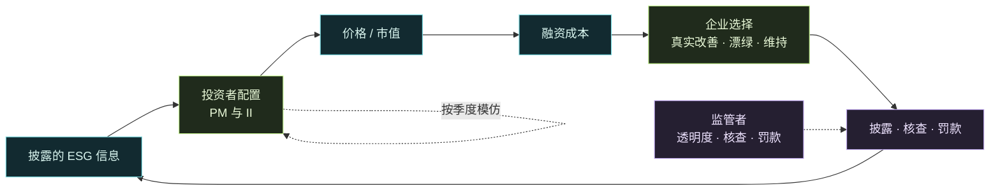

<p align="center">
  
</p>

<p align="center">
  <a href="https://github.com/kanzaler123/financial-ABM/actions/workflows/tests.yml"></a>
  <a href="https://github.com/kanzaler123/financial-ABM/actions/workflows/showcase.yml"></a>
</p>

<p align="center">
  <b>当监管遇上市场：企业为什么会漂绿？哪种政策最能推动真实的 ESG 转型？</b><br>
  多智能体人工市场 · 异质投资者演化 · 企业披露博弈 · 政策计算实验 · 证据可追溯
</p>

<p align="center">
  <a href="README.en.md"><b>English</b></a> ·
  <a href="#研究问题"><b>研究问题</b></a> ·
  <a href="#目前发现了什么"><b>目前发现</b></a> ·
  <a href="#路线图"><b>路线图</b></a> ·
  <a href="docs/README.md"><b>文档索引</b></a> ·
  <a href="#快速开始"><b>快速开始</b></a>
</p>

---

> [!NOTE]
> **研究进行中。** 市场层已经完成并审计，经验起点已按沪深 300 校准；智能体层和正式政策实验正在推进。下文每条结论都标注了证据层级，**目前还没有确认性的政策结论**。

## 研究问题

ESG 研究大多用历史数据检验相关性：ESG 好的公司收益更高吗？融资更便宜吗？这类“向后看”的方法很难回答**转型是怎样发生的**，也无法比较现实中没有发生过的政策。

本项目换一种做法：构建一个人工金融市场，让异质的投资者和企业在其中互动、学习、演化，再把政策作为可控变量放进去，做现实中做不了的反事实实验。核心问题是：

> **在政策与市场的双轮驱动下，ESG 转型的效率和路径是怎样的？**

1. **哪种政策更有效？** 提高透明度的“信息型”政策，与提高违规成本的“惩罚型”政策，在相同期望罚金下比较。
2. **市场自身的动力有多大？** 在没有外部干预时，影响力投资者能否通过“用脚投票”自发推动转型？政策是放大还是替代了这股力量？
3. **大企业和小企业有什么不同？** ESG 规范在不同规模企业之间的传导速度，是否存在“ESG 鸿沟”？
4. **什么时候会陷入漂绿陷阱？** 在参数空间中画出相图，区分“转型成功”“转型失败”和“漂绿陷阱”。

## 多智能体设计



| 参与者 | 规模 | 行为 |
|---|---|---|
| **利润导向投资者（PM）** | 1000 名投资者中的一部分 | 均值—方差配置，ESG 不进入效用 |
| **影响力投资者（II）** | 同上 | 效用中加入对披露 ESG 的偏好；两类投资者按相对业绩相互模仿，占比随时间演化 |
| **企业** | 200 家，分大、中、小三档 | 每个决策期在“真实改善 / 漂绿 / 维持”中选择：真实改善昂贵且有实施延迟；漂绿便宜、见效快，但可能被核查发现。支持 NPV 理性决策和 Q-learning 学习两种模式 |
| **监管者** | 1 | 设定透明度、核查概率、罚款和补贴，政策可以在任意日期切换 |
| **做市商与噪声交易** | — | 多资产准订单簿：价格冲击、随波动变薄的深度，现金与股份逐日守恒 |

**领域可以替换。** “真实属性 vs 披露属性”的信号博弈不只出现在 ESG 中。领域只是一份 JSON 配置，核心代码中不出现任何领域词汇，由测试强制检查。仓库内置 [ESG](configs/domains/esg.json)、[AI-washing](configs/domains/ai_washing.json)、[WBA 社会维度](configs/domains/wba_social_2023.json) 三个领域。

### 博弈论视角

每一层智能体都对应一个经典博弈，可以先写出均衡基准，再用仿真检验会学习、有限理性的智能体能否到达均衡，以及在哪里偏离。

| 层面 | 博弈 | 仿真检验什么 |
|---|---|---|
| 企业与监管者 | 检查博弈 | 罚款、核查与透明度的闭式漂绿条件，加入市场反馈后是否仍然成立 |
| 企业与投资者 | 信号博弈 | “漂绿陷阱”是否就是混同均衡；透明度和鉴证能否推向分离均衡 |
| 投资者群体 | 演化博弈（复制动态） | 影响力投资的扩张来自“选择”还是“漂移” |
| 监管者 | 斯塔克伯格博弈 | 定向核查与随机核查的比较 |

## 目前发现了什么

证据层级：**[事实]** 已核对原文的法规或数据 · **[诊断]** 对模型行为的可复核分析 · **[开发观察]** 小规模、少种子的结果 · **[待查]** 已发现、尚未查清的问题

- **[事实] 法定罚款对大公司几乎没有分量。** 《证券法》第 197 条第二款对虚假披露最多罚 1000 万元，只相当于沪深 300 市值中位数公司的约 0.01%。可持续发展报告指引对违规只规定纪律处分，没有罚款。（ESG 漂绿能否适用该条款尚不明确。）[证据表](docs/disclosure_empirical_magnitudes_20261012.md)
- **[诊断] 开发实验中企业从不漂绿，原因找到了。** 模型里的预期罚金是漂绿收益的 14.5 倍（中位数）；按经验量级换算，模型罚款约为法定上限的 50 倍，融资收益偏小 10–30 倍。如果去掉罚金，漂绿在每一次决策中都比真实改善更划算。[诊断报告](reports/disclosure_wash_diagnosis_20261012/README.md)
- **[诊断] 透明度门槛是“全有或全无”的。** 没有罚金时，透明度低于约 0.565，所有企业都选择漂绿；高于它，则全部转向真实改善。这来自同质的贴现和时间结构，正式实验需要处理这一点。
- **[开发观察] ESG 偏好投资者会推动真实改善。** 在三种初始化设定下，市场偏好效应都为正，测量窗口内约 +1.7 到 +2.5 个评分点（3 个种子，区间较宽）。[比较报告](reports/disclosure_csi300_variants_20261012/README.md)
- **[待查] 投资者演化可能主要是噪声漂移。** 在零偏好对照中，两类投资者行为完全相同，影响力投资者占比仍然上升。这正是“市场自身动力”的核心机制，下一步会用复制动态作基准来诊断。

## 路线图

- [x] **地基：单资产人工市场（Stage 1）**：冻结 v15 正式验收 22/22（见下文）
- [x] **多资产市场**：60 个固定世界审计 57 PASS / 3 FAIL（失败保留记录）；订单流重放 60/60 逐字节复现
- [x] **经验起点**：沪深 300 的 ESG 评分、半年报账面权益、市值三项都是 300/300；校准初始分布、规模相关和价值离散度
- [x] **漂绿条件诊断与经验量级检索**
- [ ] **企业博弈**：定额罚款（对应法定上限），并写出检查博弈命题
- [ ] **投资者演化**：以复制动态为基准，区分选择与漂移
- [ ] **强化学习企业**：有限理性的企业会不会“学会”漂绿
- [ ] **新智能体**：基于风险的监管者、鉴证方与评级分歧
- [ ] **正式实验**：信息型 vs 惩罚型、相图、规模鸿沟，按正式规模、用新种子、对比事先冻结
- [ ] **浏览器政策沙盘**（GitHub Pages）

详细计划与验收标准见[现行计划](docs/plan_20261013.md)。

## 研究性与可复现

- **设定先于结果。** 关键设定（初始化方式、罚款含义、融资溢价目标）在运行任何政策实验之前写入[研究契约](docs/disclosure_research_contract.md)，不为得到预期的政策排序而调参。
- **失败不删除。** 机械门槛失败、中断的运行和诊断都原样保留。
- **证据可核对。** 研究证据目录按原始字节存储，报告中记录的 SHA-256 可以直接核对；重放和插桩诊断都与归档结果逐位比对。
- **参数有出处。** 每个经验参数都在[证据表](docs/disclosure_empirical_magnitudes_20261012.md)中标注来源和可信度（原文 / 摘要 / 二手）。
- **数据边界。** 华证、东方财富等供应商数据没有开放再分发许可，不放入仓库；采集脚本和 hash 清单保留，可以重新取数逐项核对。

### 在这个项目上做研究

- **换一个领域**：写一份领域 JSON，指定方向、量表、经验分布和机制参数，例如碳排放、盈余管理、AI-washing。
- **跑你自己的政策实验**：参照 [`configs/disclosure_*_v1.json`](configs) 写一份实验配置，指定场景、种子和配对比较，运行器会输出带区间的报告。
- **引用**：见 [CITATION.cff](CITATION.cff)。

## 地基：单资产人工市场（Stage 1–3）

在加入 ESG 之前，项目先验证人工市场能否再现真实市场的典型事实（厚尾、波动聚集等），这也是申请书设定的硬性节点。

> [!IMPORTANT]
> **Stage 1 冻结版本 v15 正式验收 22/22；Stage 2 合成机制与工程验收通过。**
> v15 于 2026-09-26 使用 50 个新种子 × 16 场景完成 800 次正式仿真。验收对应[冻结源码](reports/stage1_iter6_20260926/frozen_stage1_source.zip)；代码 CI 不替代模型验收，Stage 2 的结果也不等于真实市场校准。

| 实验 | 归档检查 | 用途与边界 |
|---|---:|---|
| [开发实验 v14](reports/stage1_structural_dev_v14_20260814/mechanism_report.md) | **22 / 22** | 开发诊断，不决定阶段完成 |
| [未见种子 holdout v13](reports/stage1_structural_holdout_v13_20260814/mechanism_report.md) | **22 / 22** | 留出种子验证，不替代正式验收 |
| [正式验收 v13](reports/stage1_mechanism_acceptance_v13_20260814/mechanism_report.md) | **18 / 22** | 50 种子 × 16 场景；当时 Stage 1 未完成 |
| [正式验收 v14](reports/stage1_iter5_20260926/formal/mechanism_report.md) | **20 / 22** | 第五轮冻结正式验收；仍未通过 |
| [开发实验 v15](reports/stage1_iter6_20260926/development/mechanism_report.md) | **22 / 22** | 20 种子 × 16 场景；开发诊断 |
| [未见种子 holdout v15](reports/stage1_iter6_20260926/holdout/mechanism_report.md) | **22 / 22** | 10 种子 × 16 场景；留出验证 |
| [正式验收 v15](reports/stage1_iter6_20260926/formal/mechanism_report.md) | **22 / 22** | 50 种子 × 16 场景；[正式决策](reports/stage1_iter6_20260926/formal/final_decision.json) |

历史 v13 未通过的四项是**不依赖价格截断、波动聚集与衰减、厚尾稳定性、内生流动性对尾部的贡献**，当时的结论见 [final_decision.json](reports/stage1_mechanism_acceptance_v13_20260814/final_decision.json)。v15 的预注册、源码归档和机制分析见[第六轮报告](reports/stage1_iter6_20260926/analysis.md)，Stage 2 的边界与证据见[二阶段报告](reports/stage2_20260926/analysis.md)。

<details>
<summary><b>单资产主应用的能力与边界</b></summary>

| 模块 | 已有能力 |
|---|---|
| 价格形成 | 聚合型准订单簿，深度、价差、永久 / 暂时冲击和双信息通道 |
| 账户与审计 | 现金 / 股份守恒，持仓约束，配置与版本记录，逐日审计 |
| 策略实验 | value / trend / noise，固定人口基线；Logit 学习作为单独场景 |
| 机制验证 | 多种子消融、配对对照、预热期、检查点与冻结机制 |
| Stage 2 | 信息图传播、投资者 Bandit、企业表格 Q-learning；合成五节点与 1000 人试跑 |
| Stage 3 | 真实 SEC 8-K 快照、按会话截止时间进入的信息因子、归档重建、情景比较与 PNG/SVG 动画/数据导出；[验证与限制](reports/stage3_20261003/analysis.md) |
| 观察界面 | 本地 Web / 桌面 live、replay、batch；独立的 [GitHub 交互展厅](showcase/README.md) |

主应用的 Web / 桌面界面仍使用单资产市场；多资产披露研究是独立的子包 [`src/abm/disclosure`](src/abm/disclosure)。当前不提供逐笔连续限价订单簿、已校准的真实投资者社交网络、真实交易或公网仿真服务。主应用路线见[三阶段开发计划](docs/ABM三阶段开发计划_渐进式学习版.md)。

</details>

## 快速开始

使用 Python 3.12+，从仓库根目录执行。这是本地研究工具，不是公网部署说明。

```sh
python -m venv .venv
# Windows PowerShell: .\.venv\Scripts\Activate.ps1
# macOS / Linux: source .venv/bin/activate
python -m pip install -c requirements-lock.txt -e ".[all,dev]"
python -m pytest
```

**披露博弈实验**：

```sh
# 一个开发网格：B/I/F/IF 政策 × 市场偏好 × 规模成本 × 融资对照，3 个种子
python -m abm.disclosure.experiments --spec configs/disclosure_financing_development_v1.json --output runs/financing_dev --workers 4
```

**单资产主应用的本地界面**：

```sh
cd web
npm ci
npm run build
cd ..
abm-web --open
```

[OPERATIONS.md](OPERATIONS.md) 提供本地运行、Stage 2 配置、回放和验收复现的详细说明。

<details>
<summary><b>只预览 GitHub 展厅，不安装模型依赖</b></summary>

```sh
python showcase/build.py --output _site
python -m http.server 8080 --directory _site
```

打开 `http://localhost:8080`，或直接打开 `_site/index.html`。纯静态、离线可用；没有运行控制按钮冒充后端模拟。首次发布 Pages：仓库 **Settings → Pages → Source: GitHub Actions**，然后运行 **GitHub showcase** 工作流。详见[展示层文档](showcase/README.md)。

</details>

## 导航

[文档索引](docs/README.md) · [现行计划](docs/plan_20261013.md) · [研究契约](docs/disclosure_research_contract.md) · [证据表](docs/disclosure_empirical_magnitudes_20261012.md) · [披露博弈源码](src/abm/disclosure) · [实验报告](reports) · [配置与协议](configs) · [完整操作手册](OPERATIONS.md) · [展示层维护](showcase/README.md)

---

<sub>Financial ABM · Research prototype. 可检查的机制，可追溯的证据。非投资建议。</sub>
