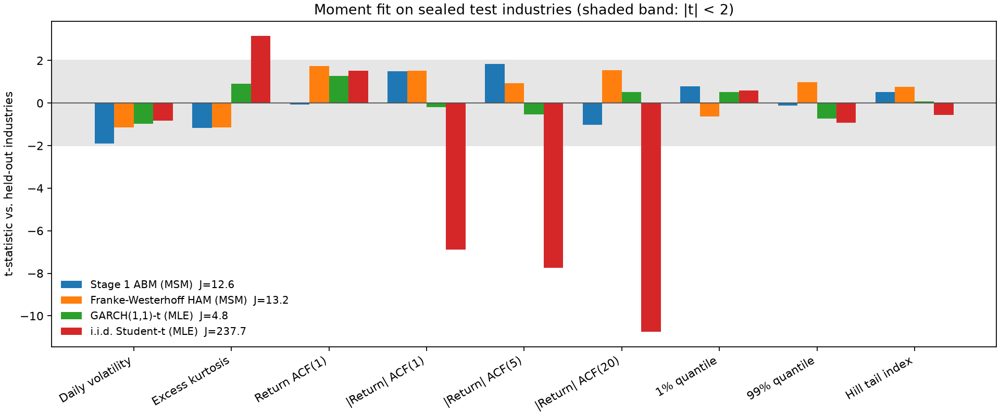
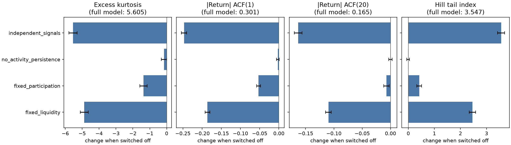

# Calibrating an auditable agent-based market to industry returns

*Technical report. Stage 1 numbers come from `reports/msm_v1_20261011/`
(`calibration.json`, `baselines.json`, `comparison.json`).*

## Abstract

We calibrate a 1,000-agent daily market with endogenous liquidity and
participation to nine return moments of 29 Fama–French industries
(2000–2025) by the simulated method of moments, and score it on 10 sealed
industries against three benchmarks fitted to the same training data. On the
held-out industries a GARCH(1,1)-t fits best (J = 4.8); the calibrated ABM
(J = 12.6) ties the Franke–Westerhoff heterogeneous-agent model (13.2), and
both are far ahead of an i.i.d. Student-t (237.7). The ABM's contribution is
mechanistic rather than statistical: with Gaussian fundamentals and no price
clamp ever binding, switching off endogenous liquidity withdrawal removes 87%
of its excess kurtosis and 62% of its lag-1 volatility clustering, and making
noise-trader demand independent removes 99%. Fat tails arise from the
interaction of correlated order flow with liquidity that thins as volatility
rises. Only two of seven parameters are well identified by these moments.

## 1. Model

The Stage 1 market trades one asset among N = 1000 heterogeneous agents at
daily frequency. Agents follow one of three fixed rules:

* **value** traders move toward a subjective value that absorbs public news
  with a lag, with a no-trade band around the price;
* **trend** traders compare short and long moving averages, with
  heterogeneous windows (5–20 and 40–120 days);
* **noise** traders submit persistent, partly correlated random demand.

Orders are netted in an aggregate quasi order book. Net share flow moves the
mid price permanently (`price_impact × net_flow / liquidity_scale`); the
order-flow surprise relative to an exponentially weighted expectation adds a
transient component that decays at rate `transient_impact_decay`. Two
feedback loops make volatility endogenous:

1. **Liquidity withdrawal.** Book depth shrinks as realized volatility rises
   above its slow-moving reference, `depth ∝ exp(−liquidity_volatility_sensitivity × stress)`.
   Thinner depth raises the transient impact of a given surprise and widens
   the spread. Under the net-share permanent-impact basis used here, depth
   does not enter the permanent component.
2. **Participation.** Agents' daily activity probability rises with realized
   volatility (`activity_volatility_sensitivity`) and order size scales with
   volatility (`demand_volatility_exponent`).

Cash and shares are conserved to 1e-8 relative error and checked every day.
The fundamental value follows a Gaussian random walk; its shocks are the only
exogenous input. Exogenous fat-tail options in the code (Student-t or GARCH
fundamentals) are switched **off** throughout this report, so any excess
kurtosis or volatility clustering comes from the trading mechanisms.

## 2. Data

Daily value-weighted returns of the 49 Fama–French industry portfolios,
2000-01-03 to 2025-12-31 (6,539 days), from the Kenneth French data library
snapshot archived under `data/raw/kenneth_french/`. Industries are split
29 / 10 / 10 into training, validation and sealed test groups by a hash of
their names (`configs/french49_split_v1.json`), fixed before any model was
fitted. Calibration uses training industries only.

## 3. Method

**Moments.** Nine statistics of daily returns: volatility, excess kurtosis,
return autocorrelation at lag 1, absolute-return autocorrelation at lags 1, 5
and 20, the 1% and 99% quantiles, and the Hill tail index of absolute
demeaned returns (top 2.5%).

**Target and noise scale.** The target is the mean moment vector of the
training industries. Its noise scale is the sampling covariance of the
moments of *one* series of the same length, estimated by a circular block
bootstrap (block length 20, 200 draws) and averaged over industries. A
simulated path is therefore judged against the uncertainty a single market
history carries.

**Objective.** With S simulated paths per parameter vector and diagonal
weight W = diag(Ω)⁻¹,

  J(θ) = Σₖ tₖ²,  tₖ = (m̄ₖ(θ) − mₖ) / (σₖ √(1 + 1/S)),

so J is a sum of squared t-statistics and each term is interpretable on its
own. A diagonal weight is used because kurtosis, quantiles and the Hill index
are strongly correlated and the full inverse covariance is ill-conditioned.
J is therefore not χ²-distributed and is used for ranking, not for a formal
overidentification test.

**Estimation.** S = 10 seeds per evaluation, reused for every parameter vector
(common random numbers), 7,539-day paths with a 1,000-day burn-in. A 256-point
scrambled Sobol screen of the parameter box is followed by bounded
Nelder–Mead refinement from the three best points. Standard errors come from
the sandwich formula with a central finite-difference Jacobian.

**Parameter selection.** A one-at-a-time sensitivity screen around the v15
configuration (4 seeds, each parameter at both bounds) decided which
parameters enter θ. Seven do: fundamental volatility, price impact, liquidity
and activity sensitivity to volatility, noise scale, the demand-volatility
exponent and the transient-impact decay. **Value and trend sensitivity were
left fixed because neither moved any daily moment by more than about one
standard error across a wide range** — a finding in itself: at daily
frequency, the strength of the fundamentalist and chartist rules is not
identified by these statistics; the feedback between volatility, liquidity and
participation is.

**Benchmarks.** Scored with the same moments, seeds and objective:

* i.i.d. Student-t, maximum likelihood — fat tails, no dynamics;
* GARCH(1,1)-t, pooled maximum likelihood over training industries with
  per-industry variance targeting;
* the Franke–Westerhoff (2012) DCA-HPM heterogeneous-agent model, calibrated
  by the same MSM routine with the same number (seven) of free parameters.

**Evaluation.** All models are re-simulated with 50 fresh seeds and scored
against the training, validation and test industries. The test score is
computed once (`abm-msm-report` refuses to overwrite `comparison.json`).

**Ablations.** At the calibrated parameters, one mechanism at a time is
switched off using the existing scenario definitions from the Stage 1
validation suite. Effects are paired by seed and reported with 95% t-intervals.

## 4. Results

**Calibration.** The Sobol screen reached J = 19.4; the three Nelder–Mead
refinements reached 10.8, 10.4 and 7.4. All three stopped at the 80-evaluation
budget, the third while still improving, so the optimum is not certified. No
simulated path failed in 496 evaluations.

| Parameter | Estimate | s.e. | Bounds |
|---|---:|---:|---|
| `fundamental_volatility` | 0.0068 | 0.0021 | 0.003–0.012 |
| `price_impact` | 0.620 | 0.235 | 0.2–1.2 |
| `liquidity_volatility_sensitivity` | 2.46 | 5.87 | 0–4 |
| `activity_volatility_sensitivity` | 1.33 | 4.55 | 0–6 |
| `noise_scale` | 2.87 | 3.15 | 0.3–3 |
| `demand_volatility_exponent` | 0.617 | 0.499 | 0.5–1.5 |
| `transient_impact_decay` | 0.919 | 1.334 | 0.6–0.99 |

Only fundamental volatility and price impact are pinned down. The condition
number of D′WD is 2.6 × 10⁸: the nine moments cannot separate the strengths of
the feedback channels, which trade off along flat directions. `noise_scale`
and `demand_volatility_exponent` sit near their bounds.

**Held-out comparison** (50 fresh seeds per model; J over nine moments):

| Model | Free params | Train | Validation | Test |
|---|---:|---:|---:|---:|
| Stage 1 ABM (MSM) | 7 | 10.0 | 10.7 | 12.6 |
| Franke–Westerhoff HAM (MSM) | 7 | 9.3 | 18.7 | 13.2 |
| GARCH(1,1)-t (MLE) | 3 + variance target | 4.8 | 13.0 | **4.8** |
| i.i.d. Student-t (MLE) | 1 + scale | 258.7 | 302.1 | 237.7 |

Three observations:

1. **GARCH wins on fit.** A three-parameter statistical model, estimated by
   likelihood rather than on these moments, matches the held-out moments
   best. Its estimates (α = 0.080, β = 0.911, ν = 7.3) are textbook values.
2. **The MSM fits overfit their calibration seeds.** On the same training
   industries, J rises from 7.4 to 10.0 (ABM) and 5.7 to 9.3 (HAM) when the
   10 calibration seeds are replaced by 50 fresh ones. Ten common-random-number
   seeds let the optimizer fit simulation noise; a future calibration should
   use more seeds or a held-out seed set inside the optimizer.
3. **ABM and HAM tie on the test group** (12.6 vs 13.2). The ABM is more
   stable across industry groups (10.0 / 10.7 / 12.6 against 9.3 / 18.7 / 13.2).
   With nine moments, a correctly specified model would score J ≈ 9 on
   average, so neither agent-based model is clearly misspecified on these
   statistics, and they cannot be ranked against each other.

The HAM estimates (φ = 0.15, χ = 1.21, σ_f = 1.05, σ_c = 4.06, α₀ = −0.46,
α_n = 2.20, α_p = 12.3) are close to those reported by Franke and Westerhoff,
which checks the benchmark implementation.

Per-moment fit on the test industries (|t| < 2 for every moment for the ABM,
HAM and GARCH; the i.i.d. model misses all volatility-clustering moments by
7–11 standard errors):



## 5. Mechanism ablations

At the calibrated parameters, 50 seeds per scenario, paired by seed:

| Switched off | Excess kurtosis (5.61) | \|r\| ACF(1) (0.301) | \|r\| ACF(20) (0.165) | Hill index (3.55) |
|---|---:|---:|---:|---:|
| Liquidity withdrawal (`fixed_liquidity`) | −4.88 (−87%) | −0.186 (−62%) | −0.110 (−66%) | +2.46 |
| Correlated noise demand (`independent_signals`) | −5.55 (−99%) | −0.247 (−82%) | −0.163 (−99%) | +3.56 |
| Volatility-driven participation (`fixed_participation`) | −1.37 (−24%) | −0.053 (−18%) | −0.007 | +0.42 |
| Activity persistence (`no_activity_persistence`) | −0.16, n.s. | −0.002, n.s. | 0.000, n.s. | −0.01, n.s. |

Full-model values in parentheses; every 95% interval except the last row
excludes zero. The price clamp (±30% per day) bound on **zero** evaluation
days in every scenario, so the tails are not an artifact of truncation.

**Interpretation.** Two ingredients are each close to necessary. Without a
common component, the demand of 1,000 noise traders largely cancels, net flow
stays small, and the volatility-dependent liquidity response is rarely
triggered. With correlated demand but fixed depth, large flows move the price
roughly linearly and tails stay thin. Fat tails and clustering appear when
correlated flow meets depth that thins as volatility rises, which raises the
transient impact of the next surprise and keeps volatility elevated. The
common demand factor is itself a Gaussian AR(1) input, so "endogenous" here
means that the non-Gaussian shape is produced by the market mechanism, not
that the order flow has no exogenous driver.

This sits beside the identification result without contradiction: the data
cannot say *how strong* the liquidity response is (s.e. 5.9), but removing it
altogether destroys the fit. The mechanism is needed; its strength is not
identified by daily return moments. Order-book depth or spread data would be
the natural next target.



## 6. Limitations

* One asset, daily frequency; no cross-section, no intraday microstructure.
* The model is matched to industry portfolios, which are themselves
  diversified; single stocks have heavier tails.
* The 2000–2025 sample contains a few crisis regimes. A stationary model
  matching its unconditional moments does not imply it reproduces when those
  regimes occur.
* Matching moments is a necessary, not sufficient, test of a mechanism. The
  ablations show what the *model* needs to produce the moments, not that
  markets work that way.
* The diagonal-weight J has no reference distribution; model ranking uses it
  descriptively.
* The parameter vector and the set of free parameters were chosen with
  training data after inspecting the v15 configuration; the sealed test
  industries were scored once, after all choices were fixed.
* Nelder–Mead stopped at its evaluation budget; a better optimum may exist.

## 7. Reproduction

```bash
abm-calibrate-msm --config configs/stage1_structural_dev_v11.json --archive <French49 zip> --split configs/french49_split_v1.json --output reports/msm_v1_<date> --screen-points 256 --workers 10
abm-baselines --archive <French49 zip> --split configs/french49_split_v1.json --output reports/msm_v1_<date>
abm-msm-report --report-dir reports/msm_v1_<date> --config configs/stage1_structural_dev_v11.json --archive <French49 zip> --split configs/french49_split_v1.json --workers 10
```

## 8. Disclosure-game extension: scope and evidence

The separate `abm.disclosure` package is an exploratory multi-asset game with
one scalar true attribute, an inflated report, improvement or maintenance,
delayed actions and regulatory audits. Domain JSON files can change labels,
units, direction, bounds, costs and delays within this mechanism family;
different payoff or information mechanisms require explicit extensions.
ESG is the first example. An ESG rating measures an observed proxy and must
not be treated as the firm's latent environmental or social performance.
The current domain parameters are uncalibrated assumptions; interior
trajectories and washing traps are illustrations, not validation
or evidence for a policy ranking.

The model's `k = cash_flow_yield * intrinsic_value / price` remains a
cash-flow-yield diagnostic, not a borrowing rate. A fixed financing exposure
F is now priced at `risk_free_rate + financing_spread * F / (F + lagged price)`
on a stated repricing calendar. Daily fees are accrued; the change from the
initial contract's fee adjusts the intrinsic-value anchor once. There is no
corporate cash account, so these records do not establish actual payment or
solvency. Pricing, exposure, discount rate and horizon remain assumptions.

Corporate decisions perturb one signal while prices, wealth, return
expectations and risk estimates stay fixed and investors rebalance under
cash and holdings constraints. This local permanent quote response is only
an input to expected financing-fee savings, not an additional payoff.
Savings are discounted daily over a finite horizon, respecting project
activation, subsequent repricing and audit survival. The eventual fine
remains a liability beyond the savings horizon. The price response is not
a forecast of a full future equilibrium. Signals, action amounts and costs
use the same fixed initial scale; real improvements respect remaining and
pending capacity. The [research contract](disclosure_research_contract.md)
specifies the cash-flow assumptions and the required channel-off controls.

To isolate transparency, keep audit probability, penalty and subsidy
each fixed and vary only transparency, as supplied by
`PolicySchedule.with_information_intervention`. Equal audit-probability times
penalty is insufficient: audits also end inflated reports, changing their
lifetime and the discounted value of fines. Social-cost efficiency must
separate real resource costs from fines and subsidies, which are transfers
between firms and government; summing all three does not measure social
resource use. Size multipliers `[0.6, 1.0, 1.6]` assume a large-firm cost
advantage, so any size-gap claim needs an equal-cost `[1, 1, 1]` control.

The extension's M1 [fresh-seed result](../reports/disclosure_m1_20261011/calibration_result.json)
has J = 41.19 against the same training-industry target. Fresh simulation
seeds test sensitivity to simulation noise; they do not constitute an
empirical data holdout. The [run log](../reports/disclosure_m1_20261011/calibration.log)
still reports return ACF(1) = -0.1758 versus -0.0275 in the target
(t = -6.13). These bare-market results do not validate the disclosure
mechanisms or policy rankings. Independent data and sensitivity analyses
remain necessary before interpreting exploratory scenarios as policy evidence.

The target also consists of industry portfolios, while each simulated asset
currently represents one firm. Matching their moments is a development
benchmark, not a validated firm-level calibration. An empirical comparison
must align observational units through individual-stock data or a specified
simulated portfolio construction; see the [French 49 construction](https://mba.tuck.dartmouth.edu/pages/faculty/ken.french/Data_Library/det_49_ind_port.html).

## References

Franke, R., & Westerhoff, F. (2012). Structural stochastic volatility in asset
pricing dynamics: Estimation and model contest. *Journal of Economic Dynamics
and Control*, 36(8), 1193–1211.
