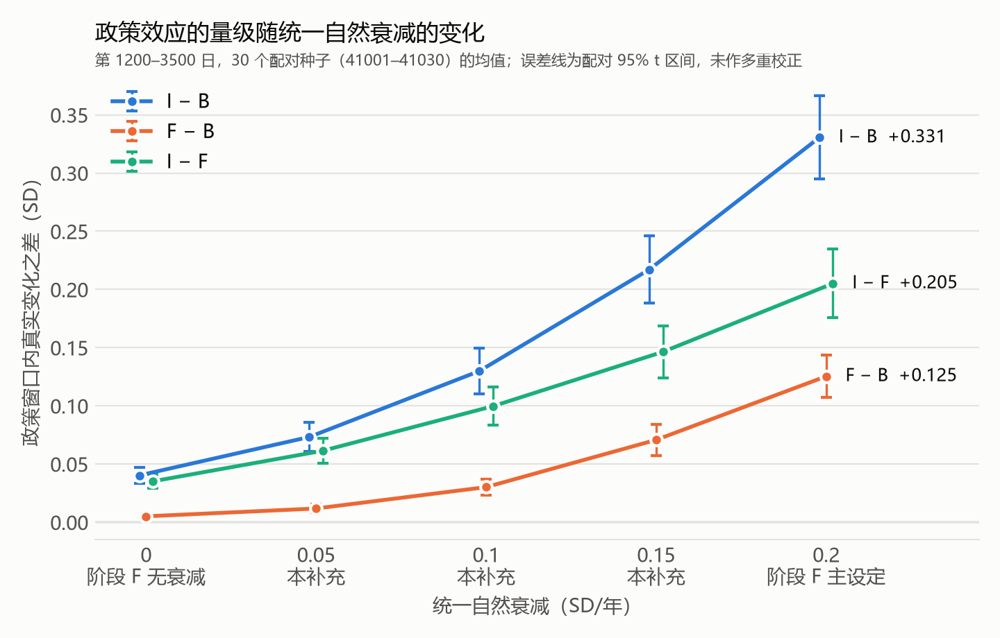

# 衰减格点补充：统一自然衰减 0–0.2 SD/年的五个格点（2026-10-16）

**性质：探索性补充，不是确认性实验。** 起因是一份外部评价：阶段 F 只检验了统一衰减 0 与 0.2 SD/年两个端点，不能说明两端之间排序都成立（见[契约第 20.15 条](../../docs/disclosure_research_contract.md#20-阶段-f核心实验2026-10-14-固定先于任何本节的运行)）。本补充在看过阶段 F 结果之后设计，但设计、格点、种子、指标和判定规则都在运行之前写入[契约第 20.16 条](../../docs/disclosure_research_contract.md#20-阶段-f核心实验2026-10-14-固定先于任何本节的运行)并提交（`e2cec47`）。

新跑 3 个格点（0.05、0.1、0.15 SD/年）× B、I、F、IF × 30 个配对种子（41001–41030，与阶段 F 相同），共 360 个世界，全部完成。`experiment_id` = `1938581…7740`。两个端点直接读阶段 F 确认性档案：0 为 E 块（decay0_*），0.2 为主设定。企业使用连续 NPV 规则。区间为跨种子的配对 95% t 区间，不作多重校正。

## 结论

1. **排序 I > F > B 在已检验的 5 个统一衰减设定下一致**（0、0.05、0.1、0.15、0.2 SD/年）。每个格点上，I − F 与 F − B 的区间都在 0 以上（契约第 20.16 条判定 1：五格都“成立”）。剔除价格截断的运行后也一样。
2. **三个对比的量级都随衰减单调递增**（判定 2：单调）。相邻格点之间的 12 段变化，配对区间都不含 0。
3. **增长是凸的：大部分效应集中在区间上半段。** 在中点 0.1 SD/年，I − B 为 +0.130，只有上端 +0.331 的 39%，低于两端线性插值的 +0.185。F − B 更明显：中点 +0.030，只有上端的 24%（插值为 +0.065）。I − F 中点 +0.100，为上端的 49%。所以第 20.14 条的区间仍然成立，但不能把区间中点当作“典型值”：除非衰减接近 0.2，政策效应更接近下端。
4. **覆盖范围。** 结论只限这 5 个统一衰减设定。格点之间、0.2 以上的衰减、向均值回归等其他衰减形式都没有检验。P1、P3、P4、剂量、比例罚和两张相图仍只有主设定（0.2）的数值。



## 1. 真实变化的对比（契约第 20.16 条）

政策窗口第 1200–3500 日的 `true_change.equal_weight_sd`，30 个种子的配对均值与 95% t 区间（SD）。

| 衰减（SD/年） | 来源 | I − B | F − B | I − F | 排序 I > F > B |
|---:|---|---|---|---|---|
| 0 | 阶段 F E 块 | +0.040 [+0.033, +0.047] | +0.005 [+0.003, +0.007] | +0.035 [+0.029, +0.041] | 成立 |
| 0.05 | 本补充 | +0.073 [+0.061, +0.086] | +0.012 [+0.008, +0.015] | +0.061 [+0.051, +0.072] | 成立 |
| 0.1 | 本补充 | +0.130 [+0.110, +0.150] | +0.030 [+0.024, +0.037] | +0.100 [+0.083, +0.116] | 成立 |
| 0.15 | 本补充 | +0.217 [+0.189, +0.246] | +0.071 [+0.057, +0.084] | +0.146 [+0.124, +0.169] | 成立 |
| 0.2 | 阶段 F 主设定 | +0.331 [+0.295, +0.366] | +0.125 [+0.107, +0.144] | +0.205 [+0.176, +0.235] | 成立 |

IF − B 在每个格点都与 I − B 相差不到 0.001（描述性，见 [grid_v1_tables.md](grid_v1_tables.md)）。两个端点的数值与阶段 F 报告一致。

**相邻格点之间的变化**（同一种子在相邻两格的对比之差，配对 95% t 区间）：

| 对比 | 0 → 0.05 | 0.05 → 0.1 | 0.1 → 0.15 | 0.15 → 0.2 | 判定 |
|---|---|---|---|---|---|
| I − B | +0.033 [+0.027, +0.039] | +0.057 [+0.049, +0.065] | +0.087 [+0.077, +0.098] | +0.113 [+0.103, +0.124] | 单调递增，逐段可分辨 |
| F − B | +0.007 [+0.005, +0.008] | +0.018 [+0.015, +0.022] | +0.041 [+0.032, +0.049] | +0.055 [+0.046, +0.064] | 单调递增，逐段可分辨 |
| I − F | +0.026 [+0.022, +0.031] | +0.038 [+0.032, +0.045] | +0.047 [+0.039, +0.055] | +0.059 [+0.047, +0.070] | 单调递增，逐段可分辨 |

每段的增幅都比前一段大，这就是第 3 条结论里的凸性。另外，F − B 增长得比 I − B 快：I − B 与 F − B 之比从 0 处的约 8 倍降到 0.2 处的 2.6 倍。

## 2. 描述：漂绿与虚报

| 衰减 | B 漂绿决策占比 | F 漂绿决策占比 | I 漂绿决策占比 | B 平均虚报（SD） | I − B 平均虚报（SD） | B 真实变化（SD） |
|---:|---:|---:|---:|---:|---|---:|
| 0 | 4.7% | 3.9% | 0 | 0.27 | −0.068 [−0.078, −0.058] | +0.134 |
| 0.05 | 8.9% | 7.3% | 0 | 0.36 | −0.117 [−0.134, −0.100] | −0.250 |
| 0.1 | 12.9% | 9.5% | 0 | 0.50 | −0.200 [−0.228, −0.172] | −0.604 |
| 0.15 | 17.5% | 11.3% | 0 | 0.70 | −0.337 [−0.379, −0.294] | −0.921 |
| 0.2 | 22.3% | 13.3% | 0 | 0.95 | −0.526 [−0.583, −0.468] | −1.196 |

- 基准场景的漂绿决策占比大致随衰减线性上升（每 0.05 SD/年约 4–5 个百分点），平均虚报则加速上升。这与阶段 F 报告的解释一致：衰减让不作为的企业评分下滑，为虚报腾出空间，政策可改变的部分随之变大。
- 信息政策（τ = 0.6）在五个格点都让漂绿决策完全停止，因此 IF 与 I 几乎相同。
- 绝对水平（最后一列）主要由假设的衰减决定，只有场景之间的差值有解释意义（契约第 20.15 条）。

## 3. 执行与质量

| 项目 | 结果 |
|---|---|
| 完成 | 360/360。其中 105 个试验的第一次尝试因本机内存耗尽失败，用 `--resume` 重算完成，见下文 |
| 流水线检查 | 指标窗口都是第 1200–3500 日。三个新格点内，四种政策切换前的虚报、融资费率和行动逐位相同（270 对，0 对不同）。[build_spec.py](build_spec.py) 核对：每个新场景把衰减改回 0 时与阶段 F 冻结的 decay0_<政策> 逐项相同，改回 0.2 时与 <政策> 逐项相同 |
| 身份 | `experiment_id` = `193858150c88741272a03ba3bc947c461781c12a7c63dad6fcad333b6f5d7740`；配置 `configs/disclosure_decay_grid_v1.json` SHA256（LF）= `abe331e2…96be`；源码哈希与阶段 F 相同（`src/abm` 未改动） |
| 核心验证 | 2 个运行出现价格截断（机械门槛 FAIL）：0.15 格点的 I 与 IF，都是种子 41016，各 1 次截断，首次在第 1213 日（切换之后）。这与阶段 F 主设定中 I、IF 的截断是同一个种子、同一天。0.05 与 0.1 格点没有截断；风格事实门槛全部通过。按第 20.9 条保留在统计中；剔除后 0.15 格点 I − B 为 +0.219、I − F 为 +0.148，排序判定不变 |
| 文件 | [analyze.py](analyze.py) → [grid_v1_analysis.json](grid_v1_analysis.json)、[grid_v1_tables.md](grid_v1_tables.md)；[plot.py](plot.py) → 上图。网格档案 `grid_v1/`（紧凑归档，约 0.56 GB）只在本地 |

**运行经过（按契约第 20.9 条如实记录）。**

1. 2026-10-16 15:33:48 以 16 进程启动（[grid_v1.log](grid_v1.log)）。
2. 16:48:32–16:48:48，系统提交内存耗尽。起因是另一个会话（契约第 20.17 条的反事实运行）在 16:48 又开了 8 个工作进程，本机同时有 32 个模拟进程；另有一个桌面程序本来就占用约 16 GB。这 16 秒内，105 个试验的 `attempt_001` 以 `MemoryError` 失败（0.15 格点的 B 27 个、I 27 个、F 26 个、IF 24 个，0.1 格点的 IF 1 个）。调度进程在一次试验开始前的身份核对中也遇到 `MemoryError` 而退出（[grid_v1.err](grid_v1.err)）。此时 244 个已完成，另有 11 个尚未开始。
3. 17:09:50 用 `--resume`、8 进程续跑（[grid_v1_resume1.log](grid_v1_resume1.log)）。冻结身份核对通过；105 个失败试验另起 `attempt_002`，11 个未开始的试验首次运行。17:54:45 全部 116 个完成，没有新的失败。失败的 `attempt_001` 及其清单都保留在档案中，`summary.json` 的每条记录都带有尝试历史。
4. **重算不改变结果。** 模拟由冻结身份和种子完全确定，内存错误不是模型给出的结果，同一试验重算只会得到它本来的结果，不能借此挑选结果，也没有更换或追加种子。佐证：0.15 格点有 13 个种子、0.1 格点有 1 个种子，四种政策中既有重算的试验，也有未受影响的试验；它们切换前的历史逐位相同（上表的配对检查）。
5. 之后，调度进程在写汇总时无限期挂起：内存耗尽后，本机的 WMI 服务停止响应；Python 3.12 的 `platform.uname()` 会查询 WMI，而导入 `scipy.stats` 会经由 `numpy.testing` 调用它。挂起的进程被手动结束；第二次无任务的 `--resume`（`grid_v1_resume2`）在同一位置挂起，也被结束。最后由 [finalize.py](finalize.py) 预先填好 `platform` 的 uname 缓存（[_no_wmi.py](_no_wmi.py)），再调用原有运行器的 `--resume` 写出汇总（[grid_v1_finalize.log](grid_v1_finalize.log)）。这一步没有任务可跑，只收集记录、计算统计和渲染。运行身份只使用 `platform.python_version()`，不经过 uname，所以身份和数值都不受影响。analyze.py 也调用同一个函数。

## 4. 对阶段 F 表述的含义

- **排序：** 按第 20.15 与 20.16 条，写成“排序（I > F > B）在已检验的 5 个统一衰减设定（0、0.05、0.1、0.15、0.2 SD/年）下一致”，不写“不依赖衰减假设”。
- **量级：** 仍按第 20.14 条报告 0 到 0.2 SD/年的区间（例如 I − B 为 +0.040 到 +0.331 SD）。区间内部单调、凸，可以补一句：“在每年 0.1 SD 的中间设定下，I − B 为 +0.130 SD。”
- **不覆盖：** 格点之间的取值、0.2 以上的衰减、向均值回归，以及只有主设定数值的其他结果。如果核实后的评级面板支持向均值回归，按第 20.14 条另起第二版。

## 5. 复现

```
python reports/disclosure_decay_grid_20261016/build_spec.py
python -m abm.disclosure.experiments --spec configs/disclosure_decay_grid_v1.json --output reports/disclosure_decay_grid_20261016/grid_v1 --workers 16
python reports/disclosure_decay_grid_20261016/analyze.py
python reports/disclosure_decay_grid_20261016/plot.py
```

如果写汇总时挂起（WMI 服务不响应），用 `finalize.py` 加同样的参数和 `--resume` 代替第二条命令再跑一次。analyze.py 还需要阶段 F 的确认性档案 `reports/disclosure_stage_f_20261014/confirmatory_v1/`。
