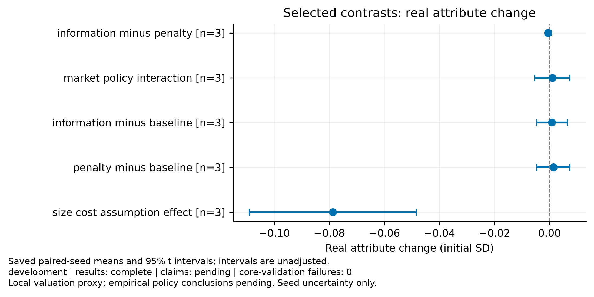
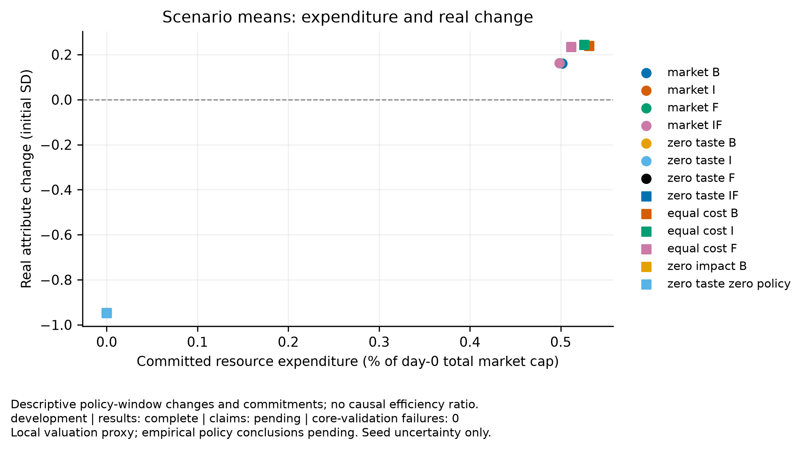
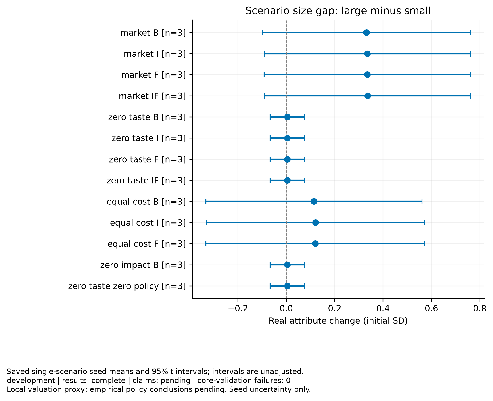

# Disclosure experiment

Purpose: development
Experiment ID: `aeb797d8e23a6f739879ce1b3389c9f804d9d5b2045f0a4463e0db46960abe0e`
Completed trials: 39/39
Trials failing core validation: 0

Claim support: pending. These results do not establish empirical calibration, real financing, or social policy efficiency.

Paired t intervals across independent seeds; primary contrasts use Holm adjustment. Intervals exclude parameter and model uncertainty. Failed seeds are not dropped. Pairing shares initial seeds and exogenous streams, not necessarily learning draws.

| Comparison | Metric | Window | Primary | Mean | Unadjusted interval | Holm p | n |
|---|---|---|---|---:|---|---:|---:|
| market_effect | true_change.equal_weight_sd | 600–1800 | False | 1.10775 | [0.722012, 1.4935] | — | 3 |
| market_effect | full_period_change.equal_weight_sd | 0–1800 | True | 1.77828 | [0.858125, 2.69844] | 0.0566255 | 3 |
| market_effect | inflation.mean_sd | 600–1800 | False | 0.042929 | [-0.0797504, 0.165608] | — | 3 |
| market_effect | size.large_minus_small_sd | 600–1800 | False | 0.326048 | [-0.0917027, 0.743799] | — | 3 |
| market_effect | costs.resource_cost | 600–1800 | False | 0.150519 | [0.000141468, 0.300896] | — | 3 |
| market_effect | costs.private_net_outflow | 600–1800 | False | 0.157864 | [-0.0185414, 0.33427] | — | 3 |
| market_effect | costs.resource_cost_fraction_initial_cap | 600–1800 | False | 0.00501729 | [4.71561e-06, 0.0100299] | — | 3 |
| information_minus_penalty | true_change.equal_weight_sd | 600–1800 | True | -0.000514159 | [-0.00162063, 0.000592309] | 0.550764 | 3 |
| information_minus_penalty | full_period_change.equal_weight_sd | 0–1800 | False | -0.000514159 | [-0.00162063, 0.000592309] | — | 3 |
| information_minus_penalty | inflation.mean_sd | 600–1800 | False | 0 | [0, 0] | — | 3 |
| information_minus_penalty | size.large_minus_small_sd | 600–1800 | False | 3.19745e-07 | [-0.00383156, 0.0038322] | — | 3 |
| information_minus_penalty | costs.resource_cost | 600–1800 | False | -0.000144857 | [-0.000709058, 0.000419344] | — | 3 |
| information_minus_penalty | costs.private_net_outflow | 600–1800 | False | -0.0222079 | [-0.110563, 0.066147] | — | 3 |
| information_minus_penalty | costs.resource_cost_fraction_initial_cap | 600–1800 | False | -4.82857e-06 | [-2.36353e-05, 1.39781e-05] | — | 3 |
| market_policy_interaction | true_change.equal_weight_sd | 600–1800 | True | 0.00107624 | [-0.00529766, 0.00745014] | 0.771327 | 3 |
| market_policy_interaction | full_period_change.equal_weight_sd | 0–1800 | False | 0.00107624 | [-0.00529766, 0.00745014] | — | 3 |
| market_policy_interaction | inflation.mean_sd | 600–1800 | False | -0.00251465 | [-0.0133343, 0.00830502] | — | 3 |
| market_policy_interaction | size.large_minus_small_sd | 600–1800 | False | 0.00448139 | [-0.0116013, 0.020564] | — | 3 |
| market_policy_interaction | costs.resource_cost | 600–1800 | False | -0.00088066 | [-0.00458478, 0.00282346] | — | 3 |
| market_policy_interaction | costs.private_net_outflow | 600–1800 | False | 0.0210748 | [-0.0625649, 0.104714] | — | 3 |
| market_policy_interaction | costs.resource_cost_fraction_initial_cap | 600–1800 | False | -2.93553e-05 | [-0.000152826, 9.41153e-05] | — | 3 |
| residual_size_gap | true_change.equal_weight_sd | 600–1800 | False | 0.239438 | [-0.161318, 0.640193] | — | 3 |
| residual_size_gap | full_period_change.equal_weight_sd | 0–1800 | False | 0.513927 | [-0.493974, 1.52183] | — | 3 |
| residual_size_gap | inflation.mean_sd | 600–1800 | False | 0.0339951 | [-0.0546417, 0.122632] | — | 3 |
| residual_size_gap | size.large_minus_small_sd | 600–1800 | True | 0.114343 | [-0.33247, 0.561156] | 0.771327 | 3 |
| residual_size_gap | costs.resource_cost | 600–1800 | False | 0.159387 | [-0.00525388, 0.324027] | — | 3 |
| residual_size_gap | costs.private_net_outflow | 600–1800 | False | 0.165668 | [-0.018724, 0.35006] | — | 3 |
| residual_size_gap | costs.resource_cost_fraction_initial_cap | 600–1800 | False | 0.00531289 | [-0.000175129, 0.0108009] | — | 3 |
| information_minus_baseline | true_change.equal_weight_sd | 600–1800 | False | 0.000881994 | [-0.00467542, 0.0064394] | — | 3 |
| information_minus_baseline | full_period_change.equal_weight_sd | 0–1800 | False | 0.000881994 | [-0.00467542, 0.0064394] | — | 3 |
| information_minus_baseline | inflation.mean_sd | 600–1800 | False | -0.00251465 | [-0.0133343, 0.00830502] | — | 3 |
| information_minus_baseline | size.large_minus_small_sd | 600–1800 | False | 0.004335 | [-0.0111198, 0.0197898] | — | 3 |
| information_minus_baseline | costs.resource_cost | 600–1800 | False | -0.000913234 | [-0.00476964, 0.00294317] | — | 3 |
| information_minus_baseline | costs.private_net_outflow | 600–1800 | False | -0.000934699 | [-0.00488071, 0.00301131] | — | 3 |
| information_minus_baseline | costs.resource_cost_fraction_initial_cap | 600–1800 | False | -3.04411e-05 | [-0.000158988, 9.81056e-05] | — | 3 |
| penalty_minus_baseline | true_change.equal_weight_sd | 600–1800 | False | 0.00139615 | [-0.0046054, 0.0073977] | — | 3 |
| penalty_minus_baseline | full_period_change.equal_weight_sd | 0–1800 | False | 0.00139615 | [-0.0046054, 0.0073977] | — | 3 |
| penalty_minus_baseline | inflation.mean_sd | 600–1800 | False | -0.00251465 | [-0.0133343, 0.00830502] | — | 3 |
| penalty_minus_baseline | size.large_minus_small_sd | 600–1800 | False | 0.00433468 | [-0.0143193, 0.0229886] | — | 3 |
| penalty_minus_baseline | costs.resource_cost | 600–1800 | False | -0.000768377 | [-0.00406143, 0.00252467] | — | 3 |
| penalty_minus_baseline | costs.private_net_outflow | 600–1800 | False | 0.0212732 | [-0.0631385, 0.105685] | — | 3 |
| penalty_minus_baseline | costs.resource_cost_fraction_initial_cap | 600–1800 | False | -2.56126e-05 | [-0.000135381, 8.41557e-05] | — | 3 |
| size_cost_assumption_effect | true_change.equal_weight_sd | 600–1800 | False | -0.0786815 | [-0.109061, -0.0483016] | — | 3 |
| size_cost_assumption_effect | full_period_change.equal_weight_sd | 0–1800 | False | -0.158831 | [-0.25879, -0.0588722] | — | 3 |
| size_cost_assumption_effect | inflation.mean_sd | 600–1800 | False | 0.0089339 | [-0.0272642, 0.045132] | — | 3 |
| size_cost_assumption_effect | size.large_minus_small_sd | 600–1800 | False | 0.216718 | [0.188524, 0.244911] | — | 3 |
| size_cost_assumption_effect | costs.resource_cost | 600–1800 | False | -0.00886782 | [-0.0326252, 0.0148896] | — | 3 |
| size_cost_assumption_effect | costs.private_net_outflow | 600–1800 | False | -0.00780399 | [-0.0331339, 0.0175259] | — | 3 |
| size_cost_assumption_effect | costs.resource_cost_fraction_initial_cap | 600–1800 | False | -0.000295594 | [-0.00108751, 0.00049632] | — | 3 |

## Figures

[PDF: policy effects](policy_effects.pdf)

[PDF: resource cost vs improvement](resource_cost_vs_improvement.pdf)

[PDF: size improvement gap](size_improvement_gap.pdf)

