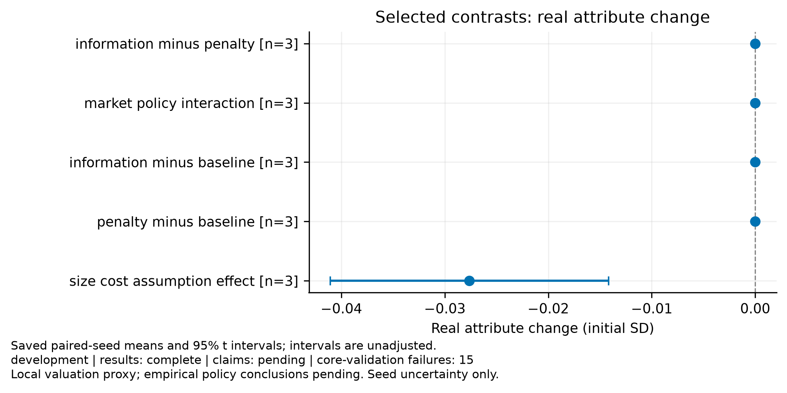
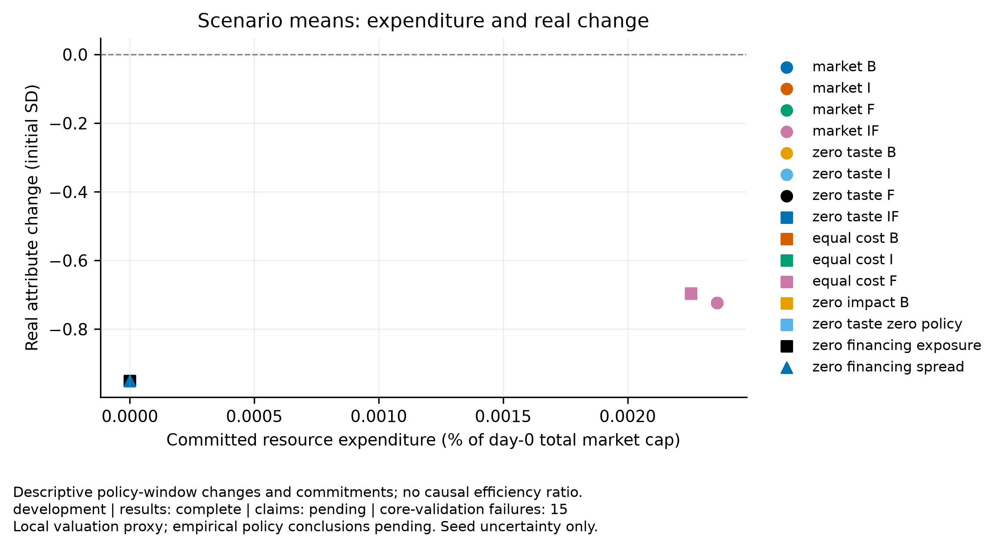
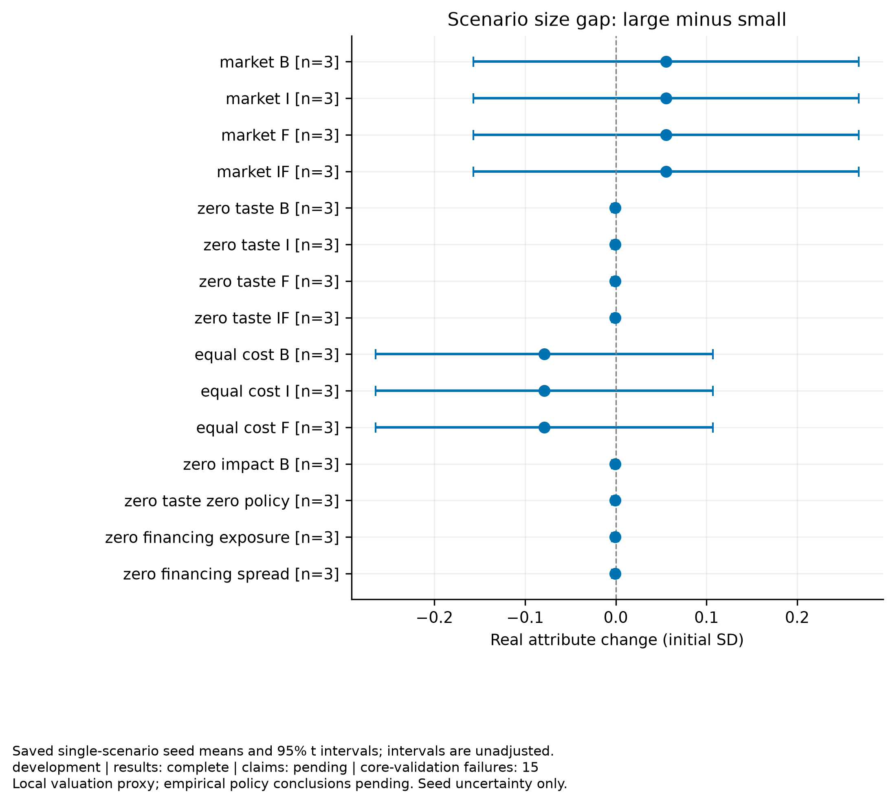

# Disclosure experiment

Purpose: development
Experiment ID: `b3fdc8ad9c89e36832e4c28b0c2ebb71b1982dbfb7e00b67d6f4768ed08d4c7a`
Completed trials: 45/45
Trials failing core validation: 15

Claim support: pending. These results do not establish empirical calibration, real financing, or social policy efficiency.

Paired t intervals across independent seeds; primary contrasts use Holm adjustment. Intervals exclude parameter and model uncertainty. Failed seeds are not dropped. Pairing shares initial seeds and exogenous streams, not necessarily learning draws.

| Comparison | Metric | Window | Primary | Mean | Unadjusted interval | Holm p | n |
|---|---|---|---|---:|---|---:|---:|
| market_effect | true_change.equal_weight_sd | 600–1800 | False | 0.226907 | [0.103099, 0.350715] | — | 3 |
| market_effect | full_period_change.equal_weight_sd | 0–1800 | True | 0.264401 | [0.108107, 0.420695] | 0.0734273 | 3 |
| market_effect | inflation.mean_sd | 600–1800 | False | 0 | [0, 0] | — | 3 |
| market_effect | size.large_minus_small_sd | 600–1800 | False | 0.0562933 | [-0.155736, 0.268322] | — | 3 |
| market_effect | costs.resource_cost | 600–1800 | False | 0.000707867 | [0.000113259, 0.00130247] | — | 3 |
| market_effect | costs.private_net_outflow | 600–1800 | False | 0.000707867 | [0.000113259, 0.00130247] | — | 3 |
| market_effect | costs.resource_cost_fraction_initial_cap | 600–1800 | False | 2.35956e-05 | [3.77529e-06, 4.34158e-05] | — | 3 |
| market_effect | financing.accrued_cost_fraction_initial_cap | 600–1800 | False | -2.85385e-05 | [-0.000119882, 6.28048e-05] | — | 3 |
| market_effect | financing.value_adjustment | 600–1800 | False | 0.000856155 | [-0.00188415, 0.00359645] | — | 3 |
| information_minus_penalty | true_change.equal_weight_sd | 600–1800 | True | 0 | [0, 0] | 1 | 3 |
| information_minus_penalty | full_period_change.equal_weight_sd | 0–1800 | False | 0 | [0, 0] | — | 3 |
| information_minus_penalty | inflation.mean_sd | 600–1800 | False | 0 | [0, 0] | — | 3 |
| information_minus_penalty | size.large_minus_small_sd | 600–1800 | False | 0 | [0, 0] | — | 3 |
| information_minus_penalty | costs.resource_cost | 600–1800 | False | 0 | [0, 0] | — | 3 |
| information_minus_penalty | costs.private_net_outflow | 600–1800 | False | 0 | [0, 0] | — | 3 |
| information_minus_penalty | costs.resource_cost_fraction_initial_cap | 600–1800 | False | 0 | [0, 0] | — | 3 |
| information_minus_penalty | financing.accrued_cost_fraction_initial_cap | 600–1800 | False | 0 | [0, 0] | — | 3 |
| information_minus_penalty | financing.value_adjustment | 600–1800 | False | 0 | [0, 0] | — | 3 |
| market_policy_interaction | true_change.equal_weight_sd | 600–1800 | True | 0 | [0, 0] | 1 | 3 |
| market_policy_interaction | full_period_change.equal_weight_sd | 0–1800 | False | 0 | [0, 0] | — | 3 |
| market_policy_interaction | inflation.mean_sd | 600–1800 | False | 0 | [0, 0] | — | 3 |
| market_policy_interaction | size.large_minus_small_sd | 600–1800 | False | 0 | [0, 0] | — | 3 |
| market_policy_interaction | costs.resource_cost | 600–1800 | False | 0 | [0, 0] | — | 3 |
| market_policy_interaction | costs.private_net_outflow | 600–1800 | False | 0 | [0, 0] | — | 3 |
| market_policy_interaction | costs.resource_cost_fraction_initial_cap | 600–1800 | False | 0 | [0, 0] | — | 3 |
| market_policy_interaction | financing.accrued_cost_fraction_initial_cap | 600–1800 | False | 0 | [0, 0] | — | 3 |
| market_policy_interaction | financing.value_adjustment | 600–1800 | False | 0 | [0, 0] | — | 3 |
| residual_size_gap | true_change.equal_weight_sd | 600–1800 | False | -0.696001 | [-0.825875, -0.566127] | — | 3 |
| residual_size_gap | full_period_change.equal_weight_sd | 0–1800 | False | -1.12851 | [-1.30095, -0.956071] | — | 3 |
| residual_size_gap | inflation.mean_sd | 600–1800 | False | 0 | [0, 0] | — | 3 |
| residual_size_gap | size.large_minus_small_sd | 600–1800 | True | -0.0788985 | [-0.264885, 0.107088] | 0.628529 | 3 |
| residual_size_gap | costs.resource_cost | 600–1800 | False | 0.000676389 | [5.61835e-05, 0.00129659] | — | 3 |
| residual_size_gap | costs.private_net_outflow | 600–1800 | False | 0.000676389 | [5.61835e-05, 0.00129659] | — | 3 |
| residual_size_gap | costs.resource_cost_fraction_initial_cap | 600–1800 | False | 2.25463e-05 | [1.87278e-06, 4.32198e-05] | — | 3 |
| residual_size_gap | financing.accrued_cost_fraction_initial_cap | 600–1800 | False | 0.0986355 | [0.0898062, 0.107465] | — | 3 |
| residual_size_gap | financing.value_adjustment | 600–1800 | False | 0.0171242 | [-0.247757, 0.282005] | — | 3 |
| information_minus_baseline | true_change.equal_weight_sd | 600–1800 | False | 0 | [0, 0] | — | 3 |
| information_minus_baseline | full_period_change.equal_weight_sd | 0–1800 | False | 0 | [0, 0] | — | 3 |
| information_minus_baseline | inflation.mean_sd | 600–1800 | False | 0 | [0, 0] | — | 3 |
| information_minus_baseline | size.large_minus_small_sd | 600–1800 | False | 0 | [0, 0] | — | 3 |
| information_minus_baseline | costs.resource_cost | 600–1800 | False | 0 | [0, 0] | — | 3 |
| information_minus_baseline | costs.private_net_outflow | 600–1800 | False | 0 | [0, 0] | — | 3 |
| information_minus_baseline | costs.resource_cost_fraction_initial_cap | 600–1800 | False | 0 | [0, 0] | — | 3 |
| information_minus_baseline | financing.accrued_cost_fraction_initial_cap | 600–1800 | False | 0 | [0, 0] | — | 3 |
| information_minus_baseline | financing.value_adjustment | 600–1800 | False | 0 | [0, 0] | — | 3 |
| penalty_minus_baseline | true_change.equal_weight_sd | 600–1800 | False | 0 | [0, 0] | — | 3 |
| penalty_minus_baseline | full_period_change.equal_weight_sd | 0–1800 | False | 0 | [0, 0] | — | 3 |
| penalty_minus_baseline | inflation.mean_sd | 600–1800 | False | 0 | [0, 0] | — | 3 |
| penalty_minus_baseline | size.large_minus_small_sd | 600–1800 | False | 0 | [0, 0] | — | 3 |
| penalty_minus_baseline | costs.resource_cost | 600–1800 | False | 0 | [0, 0] | — | 3 |
| penalty_minus_baseline | costs.private_net_outflow | 600–1800 | False | 0 | [0, 0] | — | 3 |
| penalty_minus_baseline | costs.resource_cost_fraction_initial_cap | 600–1800 | False | 0 | [0, 0] | — | 3 |
| penalty_minus_baseline | financing.accrued_cost_fraction_initial_cap | 600–1800 | False | 0 | [0, 0] | — | 3 |
| penalty_minus_baseline | financing.value_adjustment | 600–1800 | False | 0 | [0, 0] | — | 3 |
| size_cost_assumption_effect | true_change.equal_weight_sd | 600–1800 | False | -0.0276194 | [-0.0410747, -0.014164] | — | 3 |
| size_cost_assumption_effect | full_period_change.equal_weight_sd | 0–1800 | False | -0.033806 | [-0.0559338, -0.0116782] | — | 3 |
| size_cost_assumption_effect | inflation.mean_sd | 600–1800 | False | 0 | [0, 0] | — | 3 |
| size_cost_assumption_effect | size.large_minus_small_sd | 600–1800 | False | 0.134373 | [0.0719942, 0.196751] | — | 3 |
| size_cost_assumption_effect | costs.resource_cost | 600–1800 | False | 3.14775e-05 | [4.57774e-06, 5.83773e-05] | — | 3 |
| size_cost_assumption_effect | costs.private_net_outflow | 600–1800 | False | 3.14775e-05 | [4.57774e-06, 5.83773e-05] | — | 3 |
| size_cost_assumption_effect | costs.resource_cost_fraction_initial_cap | 600–1800 | False | 1.04925e-06 | [1.52591e-07, 1.94591e-06] | — | 3 |
| size_cost_assumption_effect | financing.accrued_cost_fraction_initial_cap | 600–1800 | False | 2.64168e-06 | [-1.47894e-06, 6.76229e-06] | — | 3 |
| size_cost_assumption_effect | financing.value_adjustment | 600–1800 | False | -7.92503e-05 | [-0.000202869, 4.43681e-05] | — | 3 |

## Figures

[PDF: policy effects](policy_effects.pdf)

[PDF: resource cost vs improvement](resource_cost_vs_improvement.pdf)

[PDF: size improvement gap](size_improvement_gap.pdf)

