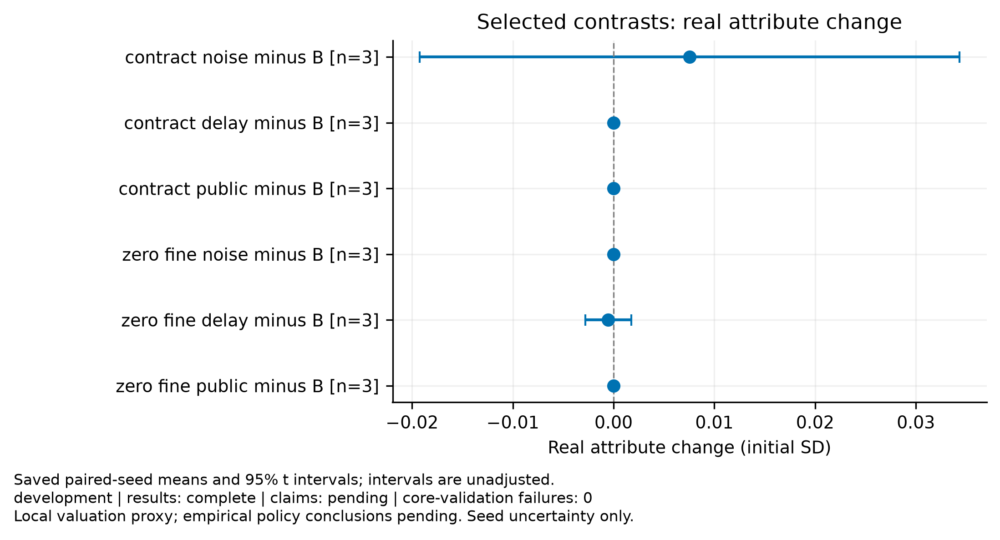
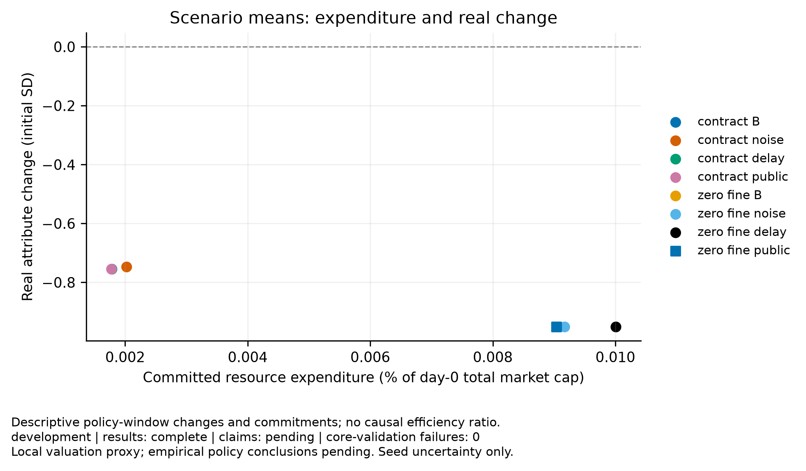
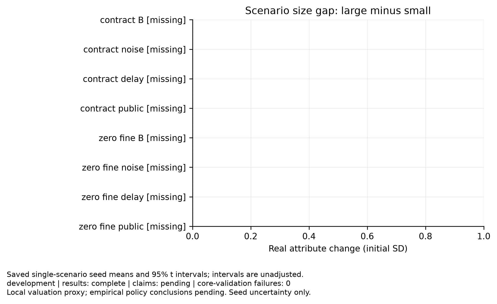

# Disclosure experiment

Purpose: development
Experiment ID: `60a754e53d432c526862e2e2fcb47159dc9e241b62400a1266fc6635960f9a4e`
Completed trials: 24/24
Trials failing core validation: 0

Claim support: pending. These results do not establish empirical calibration, real financing, or social policy efficiency.

Paired t intervals across independent seeds; primary contrasts use Holm adjustment. Intervals exclude parameter and model uncertainty. Failed seeds are not dropped. Pairing shares initial seeds and exogenous streams, not necessarily learning draws.

| Comparison | Metric | Window | Primary | Mean | Unadjusted interval | Holm p | n |
|---|---|---|---|---:|---|---:|---:|
| contract_noise_minus_B | true_change.equal_weight_sd | 600–1800 | False | 0.00754541 | [-0.0192469, 0.0343377] | — | 3 |
| contract_noise_minus_B | inflation.mean_sd | 600–1800 | False | 0 | [0, 0] | — | 3 |
| contract_noise_minus_B | costs.resource_cost_fraction_initial_cap | 600–1800 | False | 2.43345e-06 | [-5.1954e-06, 1.00623e-05] | — | 3 |
| contract_noise_minus_B | costs.fine_transfer_fraction_initial_cap | 600–1800 | False | 0 | [0, 0] | — | 3 |
| contract_noise_minus_B | financing.accrued_cost_fraction_initial_cap | 600–1800 | False | 0.000804166 | [-0.00277011, 0.00437845] | — | 3 |
| contract_noise_minus_B | impact.final_wealth_share | 600–1800 | False | 0.0323807 | [0.0174791, 0.0472824] | — | 3 |
| contract_delay_minus_B | true_change.equal_weight_sd | 600–1800 | False | 0 | [0, 0] | — | 3 |
| contract_delay_minus_B | inflation.mean_sd | 600–1800 | False | 0 | [0, 0] | — | 3 |
| contract_delay_minus_B | costs.resource_cost_fraction_initial_cap | 600–1800 | False | 0 | [0, 0] | — | 3 |
| contract_delay_minus_B | costs.fine_transfer_fraction_initial_cap | 600–1800 | False | 0 | [0, 0] | — | 3 |
| contract_delay_minus_B | financing.accrued_cost_fraction_initial_cap | 600–1800 | False | 0 | [0, 0] | — | 3 |
| contract_delay_minus_B | impact.final_wealth_share | 600–1800 | False | 0 | [0, 0] | — | 3 |
| contract_public_minus_B | true_change.equal_weight_sd | 600–1800 | False | 5.21399e-07 | [-0.000178642, 0.000179685] | — | 3 |
| contract_public_minus_B | inflation.mean_sd | 600–1800 | False | 0 | [0, 0] | — | 3 |
| contract_public_minus_B | costs.resource_cost_fraction_initial_cap | 600–1800 | False | -2.13391e-08 | [-1.303e-07, 8.76224e-08] | — | 3 |
| contract_public_minus_B | costs.fine_transfer_fraction_initial_cap | 600–1800 | False | 0 | [0, 0] | — | 3 |
| contract_public_minus_B | financing.accrued_cost_fraction_initial_cap | 600–1800 | False | -8.27159e-06 | [-6.11528e-05, 4.46096e-05] | — | 3 |
| contract_public_minus_B | impact.final_wealth_share | 600–1800 | False | 9.50337e-06 | [-2.4157e-05, 4.31638e-05] | — | 3 |
| zero_fine_noise_minus_B | true_change.equal_weight_sd | 600–1800 | False | 0 | [0, 0] | — | 3 |
| zero_fine_noise_minus_B | inflation.mean_sd | 600–1800 | False | 0.00102185 | [-0.00267598, 0.00471969] | — | 3 |
| zero_fine_noise_minus_B | costs.resource_cost_fraction_initial_cap | 600–1800 | False | 1.16181e-06 | [-4.27743e-06, 6.60106e-06] | — | 3 |
| zero_fine_noise_minus_B | costs.fine_transfer_fraction_initial_cap | 600–1800 | False | 0 | [0, 0] | — | 3 |
| zero_fine_noise_minus_B | financing.accrued_cost_fraction_initial_cap | 600–1800 | False | 0.000802711 | [-0.00266831, 0.00427373] | — | 3 |
| zero_fine_noise_minus_B | impact.final_wealth_share | 600–1800 | False | 0.0215679 | [-0.0619175, 0.105053] | — | 3 |
| zero_fine_delay_minus_B | true_change.equal_weight_sd | 600–1800 | False | -0.000529101 | [-0.00280564, 0.00174744] | — | 3 |
| zero_fine_delay_minus_B | inflation.mean_sd | 600–1800 | False | 0.0725116 | [0.0261347, 0.118888] | — | 3 |
| zero_fine_delay_minus_B | costs.resource_cost_fraction_initial_cap | 600–1800 | False | 9.55678e-06 | [-5.48437e-06, 2.45979e-05] | — | 3 |
| zero_fine_delay_minus_B | costs.fine_transfer_fraction_initial_cap | 600–1800 | False | 0 | [0, 0] | — | 3 |
| zero_fine_delay_minus_B | financing.accrued_cost_fraction_initial_cap | 600–1800 | False | -8.19349e-06 | [-6.94256e-05, 5.30386e-05] | — | 3 |
| zero_fine_delay_minus_B | impact.final_wealth_share | 600–1800 | False | 0.00823059 | [-0.0163388, 0.0328] | — | 3 |
| zero_fine_public_minus_B | true_change.equal_weight_sd | 600–1800 | False | 0 | [0, 0] | — | 3 |
| zero_fine_public_minus_B | inflation.mean_sd | 600–1800 | False | -0.000259898 | [-0.000436146, -8.36496e-05] | — | 3 |
| zero_fine_public_minus_B | costs.resource_cost_fraction_initial_cap | 600–1800 | False | -1.59389e-07 | [-5.03997e-07, 1.8522e-07] | — | 3 |
| zero_fine_public_minus_B | costs.fine_transfer_fraction_initial_cap | 600–1800 | False | 0 | [0, 0] | — | 3 |
| zero_fine_public_minus_B | financing.accrued_cost_fraction_initial_cap | 600–1800 | False | -8.3917e-06 | [-2.94765e-05, 1.26931e-05] | — | 3 |
| zero_fine_public_minus_B | impact.final_wealth_share | 600–1800 | False | 7.37917e-06 | [-8.97761e-06, 2.3736e-05] | — | 3 |

## Figures

[PDF: policy effects](policy_effects.pdf)

[PDF: resource cost vs improvement](resource_cost_vs_improvement.pdf)

[PDF: size improvement gap](size_improvement_gap.pdf)

