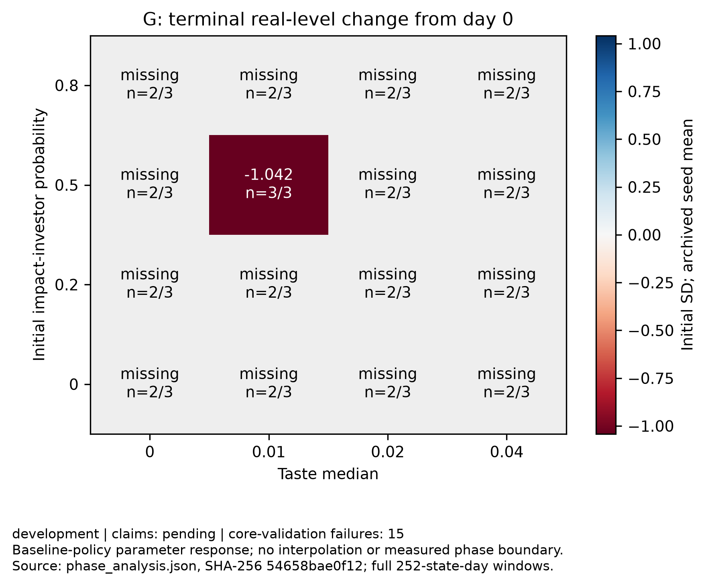
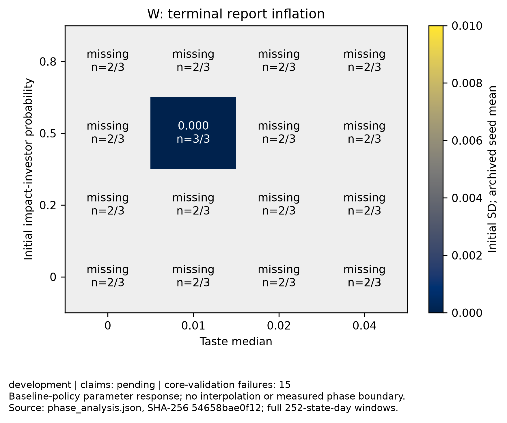

# Disclosure parameter-response analysis

Purpose: development; claim support: pending.
Experiment ID: `310726bd1b41a3232c9a764b0f156c89fbc19a719e32d3f50faa1fd9830cd8c0`
Analysis SHA-256: `54658bae0f12782bce79ee8c1ac5d60a30ddbe9f8ae9595e3d209a215007080c`

G is the last 252 state-day mean true level minus day-0 mean. W is mean inflation over the same days, without transparency weighting. Both use initial SD.
The axes are taste median and initialization probability, not realized investor or wealth shares. This finite baseline-policy grid does not identify a sharp phase boundary or policy-induced boundary movement.
Development proportions are descriptive only. Confirmatory dominant labels require at least 30 planned seeds, all complete terminal windows and passing core validation; 80% in one class, otherwise cross_seed_uncertain.
Missing or mechanically invalid trials are unclassified. Proportions use n_valid and do not impute missing seeds; incomplete cells have no dominant label or plotted continuous mean.
Class intervals are pointwise 95% Wilson score intervals, unadjusted across classes, cells and thresholds. They exclude parameter and model uncertainty. [Method](https://www.itl.nist.gov/div898/handbook/prc/section2/prc241.htm).

Core-validation failures: 15. Stylized-validation failures remain visible in descriptive results and block confirmatory dominance.

| Scenario | Taste median | Initial probability | G | W | Valid/planned | II share at burn-in | II wealth share at burn-in |
|---|---:|---:|---:|---:|---|---:|---:|
| taste_0_ii_0 | 0 | 0 | missing | missing | 2/3 | missing (day 600) | missing |
| taste_0_ii_02 | 0 | 0.2 | missing | missing | 2/3 | missing (day 600) | missing |
| taste_0_ii_05 | 0 | 0.5 | missing | missing | 2/3 | missing (day 600) | missing |
| taste_0_ii_08 | 0 | 0.8 | missing | missing | 2/3 | missing (day 600) | missing |
| taste_001_ii_0 | 0.01 | 0 | missing | missing | 2/3 | missing (day 600) | missing |
| taste_001_ii_02 | 0.01 | 0.2 | missing | missing | 2/3 | missing (day 600) | missing |
| taste_001_ii_05 | 0.01 | 0.5 | -1.04217 | 0 | 3/3 | 0.466667 (day 600) | 0.494531 |
| taste_001_ii_08 | 0.01 | 0.8 | missing | missing | 2/3 | missing (day 600) | missing |
| taste_002_ii_0 | 0.02 | 0 | missing | missing | 2/3 | missing (day 600) | missing |
| taste_002_ii_02 | 0.02 | 0.2 | missing | missing | 2/3 | missing (day 600) | missing |
| taste_002_ii_05 | 0.02 | 0.5 | missing | missing | 2/3 | missing (day 600) | missing |
| taste_002_ii_08 | 0.02 | 0.8 | missing | missing | 2/3 | missing (day 600) | missing |
| taste_004_ii_0 | 0.04 | 0 | missing | missing | 2/3 | missing (day 600) | missing |
| taste_004_ii_02 | 0.04 | 0.2 | missing | missing | 2/3 | missing (day 600) | missing |
| taste_004_ii_05 | 0.04 | 0.5 | missing | missing | 2/3 | missing (day 600) | missing |
| taste_004_ii_08 | 0.04 | 0.8 | missing | missing | 2/3 | missing (day 600) | missing |

[PDF: phase_G.pdf](phase_G.pdf)

[PDF: phase_W.pdf](phase_W.pdf)

## All threshold sensitivities

Thresholds are display assumptions, not empirically validated success criteria.

| Scenario | G cutoff | W cutoff | Real improvement | Inflation trap | Low change/low inflation | Mixed | Status | Dominant |
|---|---:|---:|---|---|---|---|---|---|
| taste_0_ii_0 | 0.125 | 0.125 | 0/2 = 0.000 [0.000, 0.658] | 0/2 = 0.000 [0.000, 0.658] | 2/2 = 1.000 [0.342, 1.000] | 0/2 = 0.000 [0.000, 0.658] | incomplete | pending |
| taste_0_ii_0 | 0.125 | 0.25 | 0/2 = 0.000 [0.000, 0.658] | 0/2 = 0.000 [0.000, 0.658] | 2/2 = 1.000 [0.342, 1.000] | 0/2 = 0.000 [0.000, 0.658] | incomplete | pending |
| taste_0_ii_0 | 0.125 | 0.5 | 0/2 = 0.000 [0.000, 0.658] | 0/2 = 0.000 [0.000, 0.658] | 2/2 = 1.000 [0.342, 1.000] | 0/2 = 0.000 [0.000, 0.658] | incomplete | pending |
| taste_0_ii_0 | 0.25 | 0.125 | 0/2 = 0.000 [0.000, 0.658] | 0/2 = 0.000 [0.000, 0.658] | 2/2 = 1.000 [0.342, 1.000] | 0/2 = 0.000 [0.000, 0.658] | incomplete | pending |
| taste_0_ii_0 | 0.25 | 0.25 | 0/2 = 0.000 [0.000, 0.658] | 0/2 = 0.000 [0.000, 0.658] | 2/2 = 1.000 [0.342, 1.000] | 0/2 = 0.000 [0.000, 0.658] | incomplete | pending |
| taste_0_ii_0 | 0.25 | 0.5 | 0/2 = 0.000 [0.000, 0.658] | 0/2 = 0.000 [0.000, 0.658] | 2/2 = 1.000 [0.342, 1.000] | 0/2 = 0.000 [0.000, 0.658] | incomplete | pending |
| taste_0_ii_0 | 0.5 | 0.125 | 0/2 = 0.000 [0.000, 0.658] | 0/2 = 0.000 [0.000, 0.658] | 2/2 = 1.000 [0.342, 1.000] | 0/2 = 0.000 [0.000, 0.658] | incomplete | pending |
| taste_0_ii_0 | 0.5 | 0.25 | 0/2 = 0.000 [0.000, 0.658] | 0/2 = 0.000 [0.000, 0.658] | 2/2 = 1.000 [0.342, 1.000] | 0/2 = 0.000 [0.000, 0.658] | incomplete | pending |
| taste_0_ii_0 | 0.5 | 0.5 | 0/2 = 0.000 [0.000, 0.658] | 0/2 = 0.000 [0.000, 0.658] | 2/2 = 1.000 [0.342, 1.000] | 0/2 = 0.000 [0.000, 0.658] | incomplete | pending |
| taste_0_ii_02 | 0.125 | 0.125 | 0/2 = 0.000 [0.000, 0.658] | 0/2 = 0.000 [0.000, 0.658] | 2/2 = 1.000 [0.342, 1.000] | 0/2 = 0.000 [0.000, 0.658] | incomplete | pending |
| taste_0_ii_02 | 0.125 | 0.25 | 0/2 = 0.000 [0.000, 0.658] | 0/2 = 0.000 [0.000, 0.658] | 2/2 = 1.000 [0.342, 1.000] | 0/2 = 0.000 [0.000, 0.658] | incomplete | pending |
| taste_0_ii_02 | 0.125 | 0.5 | 0/2 = 0.000 [0.000, 0.658] | 0/2 = 0.000 [0.000, 0.658] | 2/2 = 1.000 [0.342, 1.000] | 0/2 = 0.000 [0.000, 0.658] | incomplete | pending |
| taste_0_ii_02 | 0.25 | 0.125 | 0/2 = 0.000 [0.000, 0.658] | 0/2 = 0.000 [0.000, 0.658] | 2/2 = 1.000 [0.342, 1.000] | 0/2 = 0.000 [0.000, 0.658] | incomplete | pending |
| taste_0_ii_02 | 0.25 | 0.25 | 0/2 = 0.000 [0.000, 0.658] | 0/2 = 0.000 [0.000, 0.658] | 2/2 = 1.000 [0.342, 1.000] | 0/2 = 0.000 [0.000, 0.658] | incomplete | pending |
| taste_0_ii_02 | 0.25 | 0.5 | 0/2 = 0.000 [0.000, 0.658] | 0/2 = 0.000 [0.000, 0.658] | 2/2 = 1.000 [0.342, 1.000] | 0/2 = 0.000 [0.000, 0.658] | incomplete | pending |
| taste_0_ii_02 | 0.5 | 0.125 | 0/2 = 0.000 [0.000, 0.658] | 0/2 = 0.000 [0.000, 0.658] | 2/2 = 1.000 [0.342, 1.000] | 0/2 = 0.000 [0.000, 0.658] | incomplete | pending |
| taste_0_ii_02 | 0.5 | 0.25 | 0/2 = 0.000 [0.000, 0.658] | 0/2 = 0.000 [0.000, 0.658] | 2/2 = 1.000 [0.342, 1.000] | 0/2 = 0.000 [0.000, 0.658] | incomplete | pending |
| taste_0_ii_02 | 0.5 | 0.5 | 0/2 = 0.000 [0.000, 0.658] | 0/2 = 0.000 [0.000, 0.658] | 2/2 = 1.000 [0.342, 1.000] | 0/2 = 0.000 [0.000, 0.658] | incomplete | pending |
| taste_0_ii_05 | 0.125 | 0.125 | 0/2 = 0.000 [0.000, 0.658] | 0/2 = 0.000 [0.000, 0.658] | 2/2 = 1.000 [0.342, 1.000] | 0/2 = 0.000 [0.000, 0.658] | incomplete | pending |
| taste_0_ii_05 | 0.125 | 0.25 | 0/2 = 0.000 [0.000, 0.658] | 0/2 = 0.000 [0.000, 0.658] | 2/2 = 1.000 [0.342, 1.000] | 0/2 = 0.000 [0.000, 0.658] | incomplete | pending |
| taste_0_ii_05 | 0.125 | 0.5 | 0/2 = 0.000 [0.000, 0.658] | 0/2 = 0.000 [0.000, 0.658] | 2/2 = 1.000 [0.342, 1.000] | 0/2 = 0.000 [0.000, 0.658] | incomplete | pending |
| taste_0_ii_05 | 0.25 | 0.125 | 0/2 = 0.000 [0.000, 0.658] | 0/2 = 0.000 [0.000, 0.658] | 2/2 = 1.000 [0.342, 1.000] | 0/2 = 0.000 [0.000, 0.658] | incomplete | pending |
| taste_0_ii_05 | 0.25 | 0.25 | 0/2 = 0.000 [0.000, 0.658] | 0/2 = 0.000 [0.000, 0.658] | 2/2 = 1.000 [0.342, 1.000] | 0/2 = 0.000 [0.000, 0.658] | incomplete | pending |
| taste_0_ii_05 | 0.25 | 0.5 | 0/2 = 0.000 [0.000, 0.658] | 0/2 = 0.000 [0.000, 0.658] | 2/2 = 1.000 [0.342, 1.000] | 0/2 = 0.000 [0.000, 0.658] | incomplete | pending |
| taste_0_ii_05 | 0.5 | 0.125 | 0/2 = 0.000 [0.000, 0.658] | 0/2 = 0.000 [0.000, 0.658] | 2/2 = 1.000 [0.342, 1.000] | 0/2 = 0.000 [0.000, 0.658] | incomplete | pending |
| taste_0_ii_05 | 0.5 | 0.25 | 0/2 = 0.000 [0.000, 0.658] | 0/2 = 0.000 [0.000, 0.658] | 2/2 = 1.000 [0.342, 1.000] | 0/2 = 0.000 [0.000, 0.658] | incomplete | pending |
| taste_0_ii_05 | 0.5 | 0.5 | 0/2 = 0.000 [0.000, 0.658] | 0/2 = 0.000 [0.000, 0.658] | 2/2 = 1.000 [0.342, 1.000] | 0/2 = 0.000 [0.000, 0.658] | incomplete | pending |
| taste_0_ii_08 | 0.125 | 0.125 | 0/2 = 0.000 [0.000, 0.658] | 0/2 = 0.000 [0.000, 0.658] | 2/2 = 1.000 [0.342, 1.000] | 0/2 = 0.000 [0.000, 0.658] | incomplete | pending |
| taste_0_ii_08 | 0.125 | 0.25 | 0/2 = 0.000 [0.000, 0.658] | 0/2 = 0.000 [0.000, 0.658] | 2/2 = 1.000 [0.342, 1.000] | 0/2 = 0.000 [0.000, 0.658] | incomplete | pending |
| taste_0_ii_08 | 0.125 | 0.5 | 0/2 = 0.000 [0.000, 0.658] | 0/2 = 0.000 [0.000, 0.658] | 2/2 = 1.000 [0.342, 1.000] | 0/2 = 0.000 [0.000, 0.658] | incomplete | pending |
| taste_0_ii_08 | 0.25 | 0.125 | 0/2 = 0.000 [0.000, 0.658] | 0/2 = 0.000 [0.000, 0.658] | 2/2 = 1.000 [0.342, 1.000] | 0/2 = 0.000 [0.000, 0.658] | incomplete | pending |
| taste_0_ii_08 | 0.25 | 0.25 | 0/2 = 0.000 [0.000, 0.658] | 0/2 = 0.000 [0.000, 0.658] | 2/2 = 1.000 [0.342, 1.000] | 0/2 = 0.000 [0.000, 0.658] | incomplete | pending |
| taste_0_ii_08 | 0.25 | 0.5 | 0/2 = 0.000 [0.000, 0.658] | 0/2 = 0.000 [0.000, 0.658] | 2/2 = 1.000 [0.342, 1.000] | 0/2 = 0.000 [0.000, 0.658] | incomplete | pending |
| taste_0_ii_08 | 0.5 | 0.125 | 0/2 = 0.000 [0.000, 0.658] | 0/2 = 0.000 [0.000, 0.658] | 2/2 = 1.000 [0.342, 1.000] | 0/2 = 0.000 [0.000, 0.658] | incomplete | pending |
| taste_0_ii_08 | 0.5 | 0.25 | 0/2 = 0.000 [0.000, 0.658] | 0/2 = 0.000 [0.000, 0.658] | 2/2 = 1.000 [0.342, 1.000] | 0/2 = 0.000 [0.000, 0.658] | incomplete | pending |
| taste_0_ii_08 | 0.5 | 0.5 | 0/2 = 0.000 [0.000, 0.658] | 0/2 = 0.000 [0.000, 0.658] | 2/2 = 1.000 [0.342, 1.000] | 0/2 = 0.000 [0.000, 0.658] | incomplete | pending |
| taste_001_ii_0 | 0.125 | 0.125 | 0/2 = 0.000 [0.000, 0.658] | 0/2 = 0.000 [0.000, 0.658] | 2/2 = 1.000 [0.342, 1.000] | 0/2 = 0.000 [0.000, 0.658] | incomplete | pending |
| taste_001_ii_0 | 0.125 | 0.25 | 0/2 = 0.000 [0.000, 0.658] | 0/2 = 0.000 [0.000, 0.658] | 2/2 = 1.000 [0.342, 1.000] | 0/2 = 0.000 [0.000, 0.658] | incomplete | pending |
| taste_001_ii_0 | 0.125 | 0.5 | 0/2 = 0.000 [0.000, 0.658] | 0/2 = 0.000 [0.000, 0.658] | 2/2 = 1.000 [0.342, 1.000] | 0/2 = 0.000 [0.000, 0.658] | incomplete | pending |
| taste_001_ii_0 | 0.25 | 0.125 | 0/2 = 0.000 [0.000, 0.658] | 0/2 = 0.000 [0.000, 0.658] | 2/2 = 1.000 [0.342, 1.000] | 0/2 = 0.000 [0.000, 0.658] | incomplete | pending |
| taste_001_ii_0 | 0.25 | 0.25 | 0/2 = 0.000 [0.000, 0.658] | 0/2 = 0.000 [0.000, 0.658] | 2/2 = 1.000 [0.342, 1.000] | 0/2 = 0.000 [0.000, 0.658] | incomplete | pending |
| taste_001_ii_0 | 0.25 | 0.5 | 0/2 = 0.000 [0.000, 0.658] | 0/2 = 0.000 [0.000, 0.658] | 2/2 = 1.000 [0.342, 1.000] | 0/2 = 0.000 [0.000, 0.658] | incomplete | pending |
| taste_001_ii_0 | 0.5 | 0.125 | 0/2 = 0.000 [0.000, 0.658] | 0/2 = 0.000 [0.000, 0.658] | 2/2 = 1.000 [0.342, 1.000] | 0/2 = 0.000 [0.000, 0.658] | incomplete | pending |
| taste_001_ii_0 | 0.5 | 0.25 | 0/2 = 0.000 [0.000, 0.658] | 0/2 = 0.000 [0.000, 0.658] | 2/2 = 1.000 [0.342, 1.000] | 0/2 = 0.000 [0.000, 0.658] | incomplete | pending |
| taste_001_ii_0 | 0.5 | 0.5 | 0/2 = 0.000 [0.000, 0.658] | 0/2 = 0.000 [0.000, 0.658] | 2/2 = 1.000 [0.342, 1.000] | 0/2 = 0.000 [0.000, 0.658] | incomplete | pending |
| taste_001_ii_02 | 0.125 | 0.125 | 0/2 = 0.000 [0.000, 0.658] | 0/2 = 0.000 [0.000, 0.658] | 2/2 = 1.000 [0.342, 1.000] | 0/2 = 0.000 [0.000, 0.658] | incomplete | pending |
| taste_001_ii_02 | 0.125 | 0.25 | 0/2 = 0.000 [0.000, 0.658] | 0/2 = 0.000 [0.000, 0.658] | 2/2 = 1.000 [0.342, 1.000] | 0/2 = 0.000 [0.000, 0.658] | incomplete | pending |
| taste_001_ii_02 | 0.125 | 0.5 | 0/2 = 0.000 [0.000, 0.658] | 0/2 = 0.000 [0.000, 0.658] | 2/2 = 1.000 [0.342, 1.000] | 0/2 = 0.000 [0.000, 0.658] | incomplete | pending |
| taste_001_ii_02 | 0.25 | 0.125 | 0/2 = 0.000 [0.000, 0.658] | 0/2 = 0.000 [0.000, 0.658] | 2/2 = 1.000 [0.342, 1.000] | 0/2 = 0.000 [0.000, 0.658] | incomplete | pending |
| taste_001_ii_02 | 0.25 | 0.25 | 0/2 = 0.000 [0.000, 0.658] | 0/2 = 0.000 [0.000, 0.658] | 2/2 = 1.000 [0.342, 1.000] | 0/2 = 0.000 [0.000, 0.658] | incomplete | pending |
| taste_001_ii_02 | 0.25 | 0.5 | 0/2 = 0.000 [0.000, 0.658] | 0/2 = 0.000 [0.000, 0.658] | 2/2 = 1.000 [0.342, 1.000] | 0/2 = 0.000 [0.000, 0.658] | incomplete | pending |
| taste_001_ii_02 | 0.5 | 0.125 | 0/2 = 0.000 [0.000, 0.658] | 0/2 = 0.000 [0.000, 0.658] | 2/2 = 1.000 [0.342, 1.000] | 0/2 = 0.000 [0.000, 0.658] | incomplete | pending |
| taste_001_ii_02 | 0.5 | 0.25 | 0/2 = 0.000 [0.000, 0.658] | 0/2 = 0.000 [0.000, 0.658] | 2/2 = 1.000 [0.342, 1.000] | 0/2 = 0.000 [0.000, 0.658] | incomplete | pending |
| taste_001_ii_02 | 0.5 | 0.5 | 0/2 = 0.000 [0.000, 0.658] | 0/2 = 0.000 [0.000, 0.658] | 2/2 = 1.000 [0.342, 1.000] | 0/2 = 0.000 [0.000, 0.658] | incomplete | pending |
| taste_001_ii_05 | 0.125 | 0.125 | 0/3 = 0.000 [0.000, 0.561] | 0/3 = 0.000 [0.000, 0.561] | 3/3 = 1.000 [0.439, 1.000] | 0/3 = 0.000 [0.000, 0.561] | development_only | pending |
| taste_001_ii_05 | 0.125 | 0.25 | 0/3 = 0.000 [0.000, 0.561] | 0/3 = 0.000 [0.000, 0.561] | 3/3 = 1.000 [0.439, 1.000] | 0/3 = 0.000 [0.000, 0.561] | development_only | pending |
| taste_001_ii_05 | 0.125 | 0.5 | 0/3 = 0.000 [0.000, 0.561] | 0/3 = 0.000 [0.000, 0.561] | 3/3 = 1.000 [0.439, 1.000] | 0/3 = 0.000 [0.000, 0.561] | development_only | pending |
| taste_001_ii_05 | 0.25 | 0.125 | 0/3 = 0.000 [0.000, 0.561] | 0/3 = 0.000 [0.000, 0.561] | 3/3 = 1.000 [0.439, 1.000] | 0/3 = 0.000 [0.000, 0.561] | development_only | pending |
| taste_001_ii_05 | 0.25 | 0.25 | 0/3 = 0.000 [0.000, 0.561] | 0/3 = 0.000 [0.000, 0.561] | 3/3 = 1.000 [0.439, 1.000] | 0/3 = 0.000 [0.000, 0.561] | development_only | pending |
| taste_001_ii_05 | 0.25 | 0.5 | 0/3 = 0.000 [0.000, 0.561] | 0/3 = 0.000 [0.000, 0.561] | 3/3 = 1.000 [0.439, 1.000] | 0/3 = 0.000 [0.000, 0.561] | development_only | pending |
| taste_001_ii_05 | 0.5 | 0.125 | 0/3 = 0.000 [0.000, 0.561] | 0/3 = 0.000 [0.000, 0.561] | 3/3 = 1.000 [0.439, 1.000] | 0/3 = 0.000 [0.000, 0.561] | development_only | pending |
| taste_001_ii_05 | 0.5 | 0.25 | 0/3 = 0.000 [0.000, 0.561] | 0/3 = 0.000 [0.000, 0.561] | 3/3 = 1.000 [0.439, 1.000] | 0/3 = 0.000 [0.000, 0.561] | development_only | pending |
| taste_001_ii_05 | 0.5 | 0.5 | 0/3 = 0.000 [0.000, 0.561] | 0/3 = 0.000 [0.000, 0.561] | 3/3 = 1.000 [0.439, 1.000] | 0/3 = 0.000 [0.000, 0.561] | development_only | pending |
| taste_001_ii_08 | 0.125 | 0.125 | 0/2 = 0.000 [0.000, 0.658] | 0/2 = 0.000 [0.000, 0.658] | 2/2 = 1.000 [0.342, 1.000] | 0/2 = 0.000 [0.000, 0.658] | incomplete | pending |
| taste_001_ii_08 | 0.125 | 0.25 | 0/2 = 0.000 [0.000, 0.658] | 0/2 = 0.000 [0.000, 0.658] | 2/2 = 1.000 [0.342, 1.000] | 0/2 = 0.000 [0.000, 0.658] | incomplete | pending |
| taste_001_ii_08 | 0.125 | 0.5 | 0/2 = 0.000 [0.000, 0.658] | 0/2 = 0.000 [0.000, 0.658] | 2/2 = 1.000 [0.342, 1.000] | 0/2 = 0.000 [0.000, 0.658] | incomplete | pending |
| taste_001_ii_08 | 0.25 | 0.125 | 0/2 = 0.000 [0.000, 0.658] | 0/2 = 0.000 [0.000, 0.658] | 2/2 = 1.000 [0.342, 1.000] | 0/2 = 0.000 [0.000, 0.658] | incomplete | pending |
| taste_001_ii_08 | 0.25 | 0.25 | 0/2 = 0.000 [0.000, 0.658] | 0/2 = 0.000 [0.000, 0.658] | 2/2 = 1.000 [0.342, 1.000] | 0/2 = 0.000 [0.000, 0.658] | incomplete | pending |
| taste_001_ii_08 | 0.25 | 0.5 | 0/2 = 0.000 [0.000, 0.658] | 0/2 = 0.000 [0.000, 0.658] | 2/2 = 1.000 [0.342, 1.000] | 0/2 = 0.000 [0.000, 0.658] | incomplete | pending |
| taste_001_ii_08 | 0.5 | 0.125 | 0/2 = 0.000 [0.000, 0.658] | 0/2 = 0.000 [0.000, 0.658] | 2/2 = 1.000 [0.342, 1.000] | 0/2 = 0.000 [0.000, 0.658] | incomplete | pending |
| taste_001_ii_08 | 0.5 | 0.25 | 0/2 = 0.000 [0.000, 0.658] | 0/2 = 0.000 [0.000, 0.658] | 2/2 = 1.000 [0.342, 1.000] | 0/2 = 0.000 [0.000, 0.658] | incomplete | pending |
| taste_001_ii_08 | 0.5 | 0.5 | 0/2 = 0.000 [0.000, 0.658] | 0/2 = 0.000 [0.000, 0.658] | 2/2 = 1.000 [0.342, 1.000] | 0/2 = 0.000 [0.000, 0.658] | incomplete | pending |
| taste_002_ii_0 | 0.125 | 0.125 | 0/2 = 0.000 [0.000, 0.658] | 0/2 = 0.000 [0.000, 0.658] | 2/2 = 1.000 [0.342, 1.000] | 0/2 = 0.000 [0.000, 0.658] | incomplete | pending |
| taste_002_ii_0 | 0.125 | 0.25 | 0/2 = 0.000 [0.000, 0.658] | 0/2 = 0.000 [0.000, 0.658] | 2/2 = 1.000 [0.342, 1.000] | 0/2 = 0.000 [0.000, 0.658] | incomplete | pending |
| taste_002_ii_0 | 0.125 | 0.5 | 0/2 = 0.000 [0.000, 0.658] | 0/2 = 0.000 [0.000, 0.658] | 2/2 = 1.000 [0.342, 1.000] | 0/2 = 0.000 [0.000, 0.658] | incomplete | pending |
| taste_002_ii_0 | 0.25 | 0.125 | 0/2 = 0.000 [0.000, 0.658] | 0/2 = 0.000 [0.000, 0.658] | 2/2 = 1.000 [0.342, 1.000] | 0/2 = 0.000 [0.000, 0.658] | incomplete | pending |
| taste_002_ii_0 | 0.25 | 0.25 | 0/2 = 0.000 [0.000, 0.658] | 0/2 = 0.000 [0.000, 0.658] | 2/2 = 1.000 [0.342, 1.000] | 0/2 = 0.000 [0.000, 0.658] | incomplete | pending |
| taste_002_ii_0 | 0.25 | 0.5 | 0/2 = 0.000 [0.000, 0.658] | 0/2 = 0.000 [0.000, 0.658] | 2/2 = 1.000 [0.342, 1.000] | 0/2 = 0.000 [0.000, 0.658] | incomplete | pending |
| taste_002_ii_0 | 0.5 | 0.125 | 0/2 = 0.000 [0.000, 0.658] | 0/2 = 0.000 [0.000, 0.658] | 2/2 = 1.000 [0.342, 1.000] | 0/2 = 0.000 [0.000, 0.658] | incomplete | pending |
| taste_002_ii_0 | 0.5 | 0.25 | 0/2 = 0.000 [0.000, 0.658] | 0/2 = 0.000 [0.000, 0.658] | 2/2 = 1.000 [0.342, 1.000] | 0/2 = 0.000 [0.000, 0.658] | incomplete | pending |
| taste_002_ii_0 | 0.5 | 0.5 | 0/2 = 0.000 [0.000, 0.658] | 0/2 = 0.000 [0.000, 0.658] | 2/2 = 1.000 [0.342, 1.000] | 0/2 = 0.000 [0.000, 0.658] | incomplete | pending |
| taste_002_ii_02 | 0.125 | 0.125 | 0/2 = 0.000 [0.000, 0.658] | 0/2 = 0.000 [0.000, 0.658] | 2/2 = 1.000 [0.342, 1.000] | 0/2 = 0.000 [0.000, 0.658] | incomplete | pending |
| taste_002_ii_02 | 0.125 | 0.25 | 0/2 = 0.000 [0.000, 0.658] | 0/2 = 0.000 [0.000, 0.658] | 2/2 = 1.000 [0.342, 1.000] | 0/2 = 0.000 [0.000, 0.658] | incomplete | pending |
| taste_002_ii_02 | 0.125 | 0.5 | 0/2 = 0.000 [0.000, 0.658] | 0/2 = 0.000 [0.000, 0.658] | 2/2 = 1.000 [0.342, 1.000] | 0/2 = 0.000 [0.000, 0.658] | incomplete | pending |
| taste_002_ii_02 | 0.25 | 0.125 | 0/2 = 0.000 [0.000, 0.658] | 0/2 = 0.000 [0.000, 0.658] | 2/2 = 1.000 [0.342, 1.000] | 0/2 = 0.000 [0.000, 0.658] | incomplete | pending |
| taste_002_ii_02 | 0.25 | 0.25 | 0/2 = 0.000 [0.000, 0.658] | 0/2 = 0.000 [0.000, 0.658] | 2/2 = 1.000 [0.342, 1.000] | 0/2 = 0.000 [0.000, 0.658] | incomplete | pending |
| taste_002_ii_02 | 0.25 | 0.5 | 0/2 = 0.000 [0.000, 0.658] | 0/2 = 0.000 [0.000, 0.658] | 2/2 = 1.000 [0.342, 1.000] | 0/2 = 0.000 [0.000, 0.658] | incomplete | pending |
| taste_002_ii_02 | 0.5 | 0.125 | 0/2 = 0.000 [0.000, 0.658] | 0/2 = 0.000 [0.000, 0.658] | 2/2 = 1.000 [0.342, 1.000] | 0/2 = 0.000 [0.000, 0.658] | incomplete | pending |
| taste_002_ii_02 | 0.5 | 0.25 | 0/2 = 0.000 [0.000, 0.658] | 0/2 = 0.000 [0.000, 0.658] | 2/2 = 1.000 [0.342, 1.000] | 0/2 = 0.000 [0.000, 0.658] | incomplete | pending |
| taste_002_ii_02 | 0.5 | 0.5 | 0/2 = 0.000 [0.000, 0.658] | 0/2 = 0.000 [0.000, 0.658] | 2/2 = 1.000 [0.342, 1.000] | 0/2 = 0.000 [0.000, 0.658] | incomplete | pending |
| taste_002_ii_05 | 0.125 | 0.125 | 0/2 = 0.000 [0.000, 0.658] | 0/2 = 0.000 [0.000, 0.658] | 2/2 = 1.000 [0.342, 1.000] | 0/2 = 0.000 [0.000, 0.658] | incomplete | pending |
| taste_002_ii_05 | 0.125 | 0.25 | 0/2 = 0.000 [0.000, 0.658] | 0/2 = 0.000 [0.000, 0.658] | 2/2 = 1.000 [0.342, 1.000] | 0/2 = 0.000 [0.000, 0.658] | incomplete | pending |
| taste_002_ii_05 | 0.125 | 0.5 | 0/2 = 0.000 [0.000, 0.658] | 0/2 = 0.000 [0.000, 0.658] | 2/2 = 1.000 [0.342, 1.000] | 0/2 = 0.000 [0.000, 0.658] | incomplete | pending |
| taste_002_ii_05 | 0.25 | 0.125 | 0/2 = 0.000 [0.000, 0.658] | 0/2 = 0.000 [0.000, 0.658] | 2/2 = 1.000 [0.342, 1.000] | 0/2 = 0.000 [0.000, 0.658] | incomplete | pending |
| taste_002_ii_05 | 0.25 | 0.25 | 0/2 = 0.000 [0.000, 0.658] | 0/2 = 0.000 [0.000, 0.658] | 2/2 = 1.000 [0.342, 1.000] | 0/2 = 0.000 [0.000, 0.658] | incomplete | pending |
| taste_002_ii_05 | 0.25 | 0.5 | 0/2 = 0.000 [0.000, 0.658] | 0/2 = 0.000 [0.000, 0.658] | 2/2 = 1.000 [0.342, 1.000] | 0/2 = 0.000 [0.000, 0.658] | incomplete | pending |
| taste_002_ii_05 | 0.5 | 0.125 | 0/2 = 0.000 [0.000, 0.658] | 0/2 = 0.000 [0.000, 0.658] | 2/2 = 1.000 [0.342, 1.000] | 0/2 = 0.000 [0.000, 0.658] | incomplete | pending |
| taste_002_ii_05 | 0.5 | 0.25 | 0/2 = 0.000 [0.000, 0.658] | 0/2 = 0.000 [0.000, 0.658] | 2/2 = 1.000 [0.342, 1.000] | 0/2 = 0.000 [0.000, 0.658] | incomplete | pending |
| taste_002_ii_05 | 0.5 | 0.5 | 0/2 = 0.000 [0.000, 0.658] | 0/2 = 0.000 [0.000, 0.658] | 2/2 = 1.000 [0.342, 1.000] | 0/2 = 0.000 [0.000, 0.658] | incomplete | pending |
| taste_002_ii_08 | 0.125 | 0.125 | 0/2 = 0.000 [0.000, 0.658] | 0/2 = 0.000 [0.000, 0.658] | 2/2 = 1.000 [0.342, 1.000] | 0/2 = 0.000 [0.000, 0.658] | incomplete | pending |
| taste_002_ii_08 | 0.125 | 0.25 | 0/2 = 0.000 [0.000, 0.658] | 0/2 = 0.000 [0.000, 0.658] | 2/2 = 1.000 [0.342, 1.000] | 0/2 = 0.000 [0.000, 0.658] | incomplete | pending |
| taste_002_ii_08 | 0.125 | 0.5 | 0/2 = 0.000 [0.000, 0.658] | 0/2 = 0.000 [0.000, 0.658] | 2/2 = 1.000 [0.342, 1.000] | 0/2 = 0.000 [0.000, 0.658] | incomplete | pending |
| taste_002_ii_08 | 0.25 | 0.125 | 0/2 = 0.000 [0.000, 0.658] | 0/2 = 0.000 [0.000, 0.658] | 2/2 = 1.000 [0.342, 1.000] | 0/2 = 0.000 [0.000, 0.658] | incomplete | pending |
| taste_002_ii_08 | 0.25 | 0.25 | 0/2 = 0.000 [0.000, 0.658] | 0/2 = 0.000 [0.000, 0.658] | 2/2 = 1.000 [0.342, 1.000] | 0/2 = 0.000 [0.000, 0.658] | incomplete | pending |
| taste_002_ii_08 | 0.25 | 0.5 | 0/2 = 0.000 [0.000, 0.658] | 0/2 = 0.000 [0.000, 0.658] | 2/2 = 1.000 [0.342, 1.000] | 0/2 = 0.000 [0.000, 0.658] | incomplete | pending |
| taste_002_ii_08 | 0.5 | 0.125 | 0/2 = 0.000 [0.000, 0.658] | 0/2 = 0.000 [0.000, 0.658] | 2/2 = 1.000 [0.342, 1.000] | 0/2 = 0.000 [0.000, 0.658] | incomplete | pending |
| taste_002_ii_08 | 0.5 | 0.25 | 0/2 = 0.000 [0.000, 0.658] | 0/2 = 0.000 [0.000, 0.658] | 2/2 = 1.000 [0.342, 1.000] | 0/2 = 0.000 [0.000, 0.658] | incomplete | pending |
| taste_002_ii_08 | 0.5 | 0.5 | 0/2 = 0.000 [0.000, 0.658] | 0/2 = 0.000 [0.000, 0.658] | 2/2 = 1.000 [0.342, 1.000] | 0/2 = 0.000 [0.000, 0.658] | incomplete | pending |
| taste_004_ii_0 | 0.125 | 0.125 | 0/2 = 0.000 [0.000, 0.658] | 0/2 = 0.000 [0.000, 0.658] | 2/2 = 1.000 [0.342, 1.000] | 0/2 = 0.000 [0.000, 0.658] | incomplete | pending |
| taste_004_ii_0 | 0.125 | 0.25 | 0/2 = 0.000 [0.000, 0.658] | 0/2 = 0.000 [0.000, 0.658] | 2/2 = 1.000 [0.342, 1.000] | 0/2 = 0.000 [0.000, 0.658] | incomplete | pending |
| taste_004_ii_0 | 0.125 | 0.5 | 0/2 = 0.000 [0.000, 0.658] | 0/2 = 0.000 [0.000, 0.658] | 2/2 = 1.000 [0.342, 1.000] | 0/2 = 0.000 [0.000, 0.658] | incomplete | pending |
| taste_004_ii_0 | 0.25 | 0.125 | 0/2 = 0.000 [0.000, 0.658] | 0/2 = 0.000 [0.000, 0.658] | 2/2 = 1.000 [0.342, 1.000] | 0/2 = 0.000 [0.000, 0.658] | incomplete | pending |
| taste_004_ii_0 | 0.25 | 0.25 | 0/2 = 0.000 [0.000, 0.658] | 0/2 = 0.000 [0.000, 0.658] | 2/2 = 1.000 [0.342, 1.000] | 0/2 = 0.000 [0.000, 0.658] | incomplete | pending |
| taste_004_ii_0 | 0.25 | 0.5 | 0/2 = 0.000 [0.000, 0.658] | 0/2 = 0.000 [0.000, 0.658] | 2/2 = 1.000 [0.342, 1.000] | 0/2 = 0.000 [0.000, 0.658] | incomplete | pending |
| taste_004_ii_0 | 0.5 | 0.125 | 0/2 = 0.000 [0.000, 0.658] | 0/2 = 0.000 [0.000, 0.658] | 2/2 = 1.000 [0.342, 1.000] | 0/2 = 0.000 [0.000, 0.658] | incomplete | pending |
| taste_004_ii_0 | 0.5 | 0.25 | 0/2 = 0.000 [0.000, 0.658] | 0/2 = 0.000 [0.000, 0.658] | 2/2 = 1.000 [0.342, 1.000] | 0/2 = 0.000 [0.000, 0.658] | incomplete | pending |
| taste_004_ii_0 | 0.5 | 0.5 | 0/2 = 0.000 [0.000, 0.658] | 0/2 = 0.000 [0.000, 0.658] | 2/2 = 1.000 [0.342, 1.000] | 0/2 = 0.000 [0.000, 0.658] | incomplete | pending |
| taste_004_ii_02 | 0.125 | 0.125 | 0/2 = 0.000 [0.000, 0.658] | 0/2 = 0.000 [0.000, 0.658] | 2/2 = 1.000 [0.342, 1.000] | 0/2 = 0.000 [0.000, 0.658] | incomplete | pending |
| taste_004_ii_02 | 0.125 | 0.25 | 0/2 = 0.000 [0.000, 0.658] | 0/2 = 0.000 [0.000, 0.658] | 2/2 = 1.000 [0.342, 1.000] | 0/2 = 0.000 [0.000, 0.658] | incomplete | pending |
| taste_004_ii_02 | 0.125 | 0.5 | 0/2 = 0.000 [0.000, 0.658] | 0/2 = 0.000 [0.000, 0.658] | 2/2 = 1.000 [0.342, 1.000] | 0/2 = 0.000 [0.000, 0.658] | incomplete | pending |
| taste_004_ii_02 | 0.25 | 0.125 | 0/2 = 0.000 [0.000, 0.658] | 0/2 = 0.000 [0.000, 0.658] | 2/2 = 1.000 [0.342, 1.000] | 0/2 = 0.000 [0.000, 0.658] | incomplete | pending |
| taste_004_ii_02 | 0.25 | 0.25 | 0/2 = 0.000 [0.000, 0.658] | 0/2 = 0.000 [0.000, 0.658] | 2/2 = 1.000 [0.342, 1.000] | 0/2 = 0.000 [0.000, 0.658] | incomplete | pending |
| taste_004_ii_02 | 0.25 | 0.5 | 0/2 = 0.000 [0.000, 0.658] | 0/2 = 0.000 [0.000, 0.658] | 2/2 = 1.000 [0.342, 1.000] | 0/2 = 0.000 [0.000, 0.658] | incomplete | pending |
| taste_004_ii_02 | 0.5 | 0.125 | 0/2 = 0.000 [0.000, 0.658] | 0/2 = 0.000 [0.000, 0.658] | 2/2 = 1.000 [0.342, 1.000] | 0/2 = 0.000 [0.000, 0.658] | incomplete | pending |
| taste_004_ii_02 | 0.5 | 0.25 | 0/2 = 0.000 [0.000, 0.658] | 0/2 = 0.000 [0.000, 0.658] | 2/2 = 1.000 [0.342, 1.000] | 0/2 = 0.000 [0.000, 0.658] | incomplete | pending |
| taste_004_ii_02 | 0.5 | 0.5 | 0/2 = 0.000 [0.000, 0.658] | 0/2 = 0.000 [0.000, 0.658] | 2/2 = 1.000 [0.342, 1.000] | 0/2 = 0.000 [0.000, 0.658] | incomplete | pending |
| taste_004_ii_05 | 0.125 | 0.125 | 0/2 = 0.000 [0.000, 0.658] | 0/2 = 0.000 [0.000, 0.658] | 2/2 = 1.000 [0.342, 1.000] | 0/2 = 0.000 [0.000, 0.658] | incomplete | pending |
| taste_004_ii_05 | 0.125 | 0.25 | 0/2 = 0.000 [0.000, 0.658] | 0/2 = 0.000 [0.000, 0.658] | 2/2 = 1.000 [0.342, 1.000] | 0/2 = 0.000 [0.000, 0.658] | incomplete | pending |
| taste_004_ii_05 | 0.125 | 0.5 | 0/2 = 0.000 [0.000, 0.658] | 0/2 = 0.000 [0.000, 0.658] | 2/2 = 1.000 [0.342, 1.000] | 0/2 = 0.000 [0.000, 0.658] | incomplete | pending |
| taste_004_ii_05 | 0.25 | 0.125 | 0/2 = 0.000 [0.000, 0.658] | 0/2 = 0.000 [0.000, 0.658] | 2/2 = 1.000 [0.342, 1.000] | 0/2 = 0.000 [0.000, 0.658] | incomplete | pending |
| taste_004_ii_05 | 0.25 | 0.25 | 0/2 = 0.000 [0.000, 0.658] | 0/2 = 0.000 [0.000, 0.658] | 2/2 = 1.000 [0.342, 1.000] | 0/2 = 0.000 [0.000, 0.658] | incomplete | pending |
| taste_004_ii_05 | 0.25 | 0.5 | 0/2 = 0.000 [0.000, 0.658] | 0/2 = 0.000 [0.000, 0.658] | 2/2 = 1.000 [0.342, 1.000] | 0/2 = 0.000 [0.000, 0.658] | incomplete | pending |
| taste_004_ii_05 | 0.5 | 0.125 | 0/2 = 0.000 [0.000, 0.658] | 0/2 = 0.000 [0.000, 0.658] | 2/2 = 1.000 [0.342, 1.000] | 0/2 = 0.000 [0.000, 0.658] | incomplete | pending |
| taste_004_ii_05 | 0.5 | 0.25 | 0/2 = 0.000 [0.000, 0.658] | 0/2 = 0.000 [0.000, 0.658] | 2/2 = 1.000 [0.342, 1.000] | 0/2 = 0.000 [0.000, 0.658] | incomplete | pending |
| taste_004_ii_05 | 0.5 | 0.5 | 0/2 = 0.000 [0.000, 0.658] | 0/2 = 0.000 [0.000, 0.658] | 2/2 = 1.000 [0.342, 1.000] | 0/2 = 0.000 [0.000, 0.658] | incomplete | pending |
| taste_004_ii_08 | 0.125 | 0.125 | 0/2 = 0.000 [0.000, 0.658] | 0/2 = 0.000 [0.000, 0.658] | 2/2 = 1.000 [0.342, 1.000] | 0/2 = 0.000 [0.000, 0.658] | incomplete | pending |
| taste_004_ii_08 | 0.125 | 0.25 | 0/2 = 0.000 [0.000, 0.658] | 0/2 = 0.000 [0.000, 0.658] | 2/2 = 1.000 [0.342, 1.000] | 0/2 = 0.000 [0.000, 0.658] | incomplete | pending |
| taste_004_ii_08 | 0.125 | 0.5 | 0/2 = 0.000 [0.000, 0.658] | 0/2 = 0.000 [0.000, 0.658] | 2/2 = 1.000 [0.342, 1.000] | 0/2 = 0.000 [0.000, 0.658] | incomplete | pending |
| taste_004_ii_08 | 0.25 | 0.125 | 0/2 = 0.000 [0.000, 0.658] | 0/2 = 0.000 [0.000, 0.658] | 2/2 = 1.000 [0.342, 1.000] | 0/2 = 0.000 [0.000, 0.658] | incomplete | pending |
| taste_004_ii_08 | 0.25 | 0.25 | 0/2 = 0.000 [0.000, 0.658] | 0/2 = 0.000 [0.000, 0.658] | 2/2 = 1.000 [0.342, 1.000] | 0/2 = 0.000 [0.000, 0.658] | incomplete | pending |
| taste_004_ii_08 | 0.25 | 0.5 | 0/2 = 0.000 [0.000, 0.658] | 0/2 = 0.000 [0.000, 0.658] | 2/2 = 1.000 [0.342, 1.000] | 0/2 = 0.000 [0.000, 0.658] | incomplete | pending |
| taste_004_ii_08 | 0.5 | 0.125 | 0/2 = 0.000 [0.000, 0.658] | 0/2 = 0.000 [0.000, 0.658] | 2/2 = 1.000 [0.342, 1.000] | 0/2 = 0.000 [0.000, 0.658] | incomplete | pending |
| taste_004_ii_08 | 0.5 | 0.25 | 0/2 = 0.000 [0.000, 0.658] | 0/2 = 0.000 [0.000, 0.658] | 2/2 = 1.000 [0.342, 1.000] | 0/2 = 0.000 [0.000, 0.658] | incomplete | pending |
| taste_004_ii_08 | 0.5 | 0.5 | 0/2 = 0.000 [0.000, 0.658] | 0/2 = 0.000 [0.000, 0.658] | 2/2 = 1.000 [0.342, 1.000] | 0/2 = 0.000 [0.000, 0.658] | incomplete | pending |

## Unclassified observations

- taste_0_ii_0, seed 22002: mechanical_validation_failed
- taste_0_ii_02, seed 22002: mechanical_validation_failed
- taste_0_ii_05, seed 22002: mechanical_validation_failed
- taste_0_ii_08, seed 22002: mechanical_validation_failed
- taste_001_ii_0, seed 22002: mechanical_validation_failed
- taste_001_ii_02, seed 22002: mechanical_validation_failed
- taste_001_ii_08, seed 22002: mechanical_validation_failed
- taste_002_ii_0, seed 22002: mechanical_validation_failed
- taste_002_ii_02, seed 22002: mechanical_validation_failed
- taste_002_ii_05, seed 22002: mechanical_validation_failed
- taste_002_ii_08, seed 22002: mechanical_validation_failed
- taste_004_ii_0, seed 22002: mechanical_validation_failed
- taste_004_ii_02, seed 22002: mechanical_validation_failed
- taste_004_ii_05, seed 22002: mechanical_validation_failed
- taste_004_ii_08, seed 22002: mechanical_validation_failed
