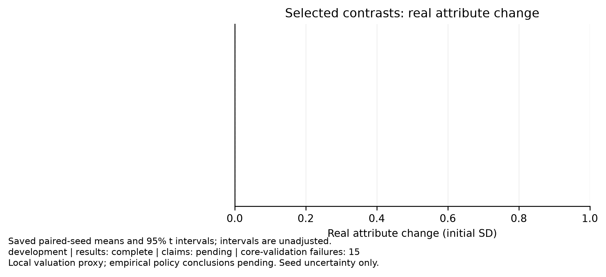
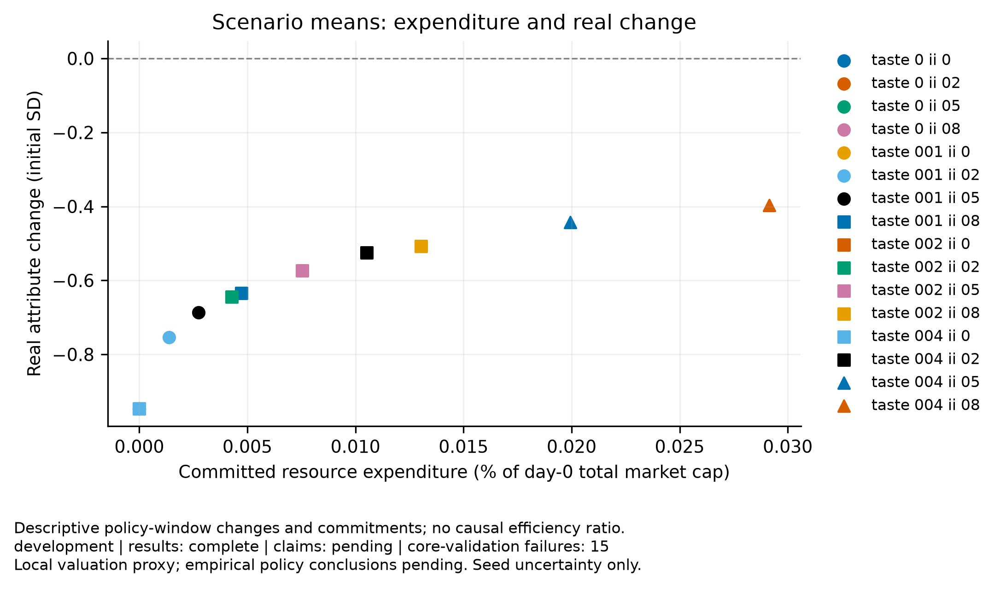
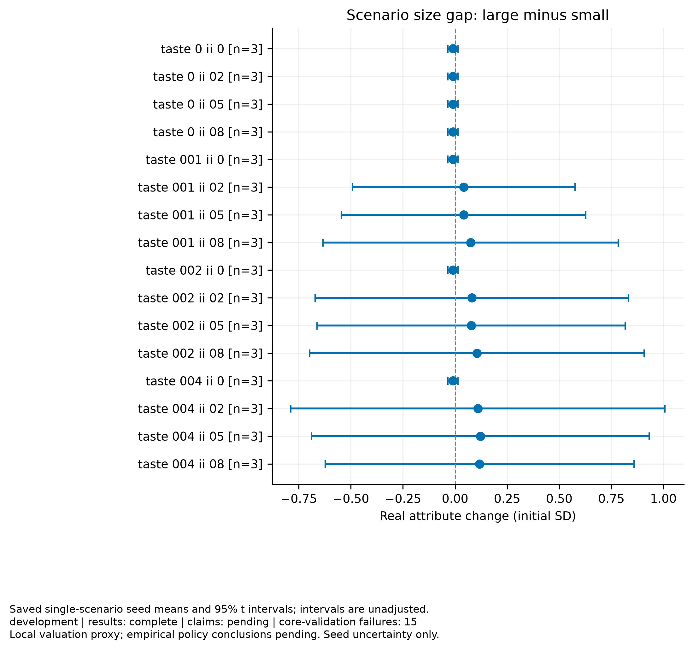

# Disclosure experiment

Purpose: development
Experiment ID: `310726bd1b41a3232c9a764b0f156c89fbc19a719e32d3f50faa1fd9830cd8c0`
Completed trials: 48/48
Trials failing core validation: 15

Claim support: pending. These results do not establish empirical calibration, real financing, or social policy efficiency.

Paired t intervals across independent seeds; primary contrasts use Holm adjustment. Intervals exclude parameter and model uncertainty. Failed seeds are not dropped. Pairing shares initial seeds and exogenous streams, not necessarily learning draws.

| Comparison | Metric | Window | Primary | Mean | Unadjusted interval | Holm p | n |
|---|---|---|---|---:|---|---:|---:|

## Figures

[PDF: policy effects](policy_effects.pdf)

[PDF: resource cost vs improvement](resource_cost_vs_improvement.pdf)

[PDF: size improvement gap](size_improvement_gap.pdf)

