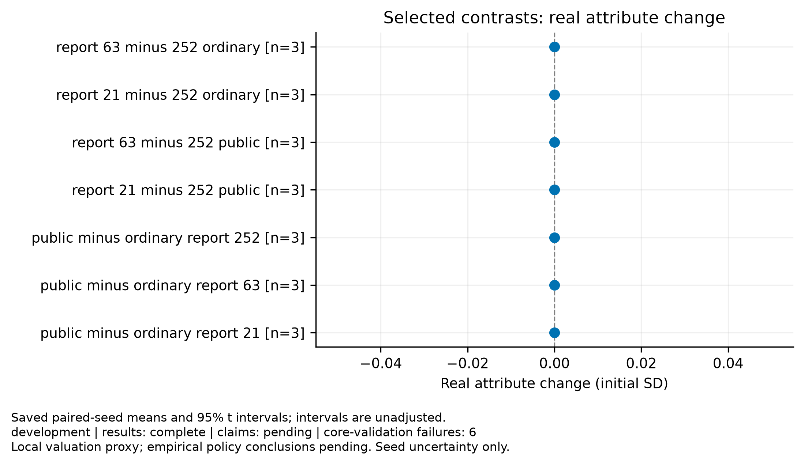
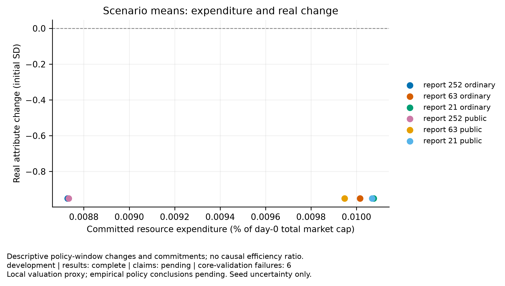
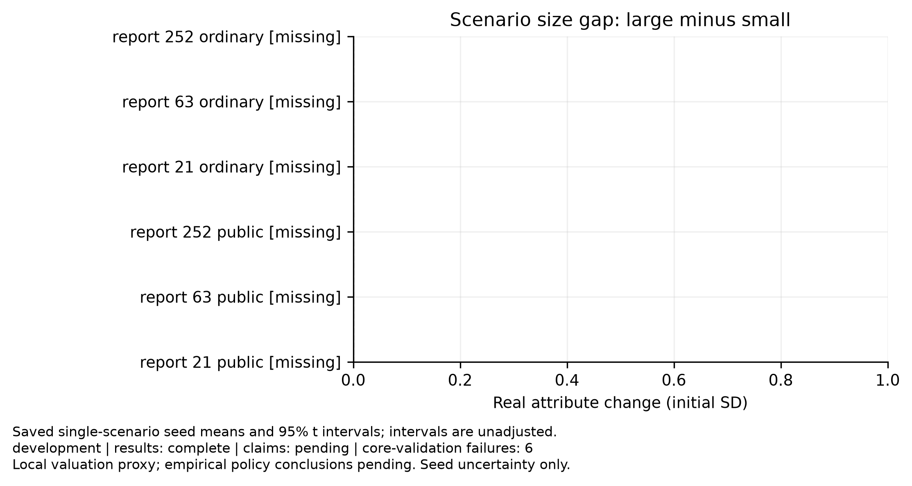

# Disclosure experiment

Purpose: development
Experiment ID: `01176fafb9c42d3eb49b7661938b2ef21ae1bd62885fafbf156ad23bb6c2e20b`
Completed trials: 18/18
Trials failing core validation: 6

Claim support: pending. These results do not establish empirical calibration, real financing, or social policy efficiency.

Paired t intervals across independent seeds; primary contrasts use Holm adjustment. Intervals exclude parameter and model uncertainty. Failed seeds are not dropped. Pairing shares initial seeds and exogenous streams, not necessarily learning draws.

| Comparison | Metric | Window | Primary | Mean | Unadjusted interval | Holm p | n |
|---|---|---|---|---:|---|---:|---:|
| report_63_minus_252_ordinary | true_change.equal_weight_sd | 600–1800 | False | 0 | [0, 0] | — | 3 |
| report_63_minus_252_ordinary | inflation.mean_sd | 600–1800 | False | 0.0313502 | [0.0211106, 0.0415897] | — | 3 |
| report_63_minus_252_ordinary | costs.resource_cost_fraction_initial_cap | 600–1800 | False | 1.28657e-05 | [-2.09806e-06, 2.78295e-05] | — | 3 |
| report_63_minus_252_ordinary | costs.fine_transfer_fraction_initial_cap | 600–1800 | False | 0 | [0, 0] | — | 3 |
| report_63_minus_252_ordinary | financing.accrued_cost_fraction_initial_cap | 600–1800 | False | -7.53135e-06 | [-0.000304393, 0.000289331] | — | 3 |
| report_63_minus_252_ordinary | impact.final_wealth_share | 600–1800 | False | -0.00216076 | [-0.0222884, 0.0179669] | — | 3 |
| report_21_minus_252_ordinary | true_change.equal_weight_sd | 600–1800 | False | 0 | [0, 0] | — | 3 |
| report_21_minus_252_ordinary | inflation.mean_sd | 600–1800 | False | 0.0280058 | [0.00551585, 0.0504958] | — | 3 |
| report_21_minus_252_ordinary | costs.resource_cost_fraction_initial_cap | 600–1800 | False | 1.34696e-05 | [-5.36462e-06, 3.23038e-05] | — | 3 |
| report_21_minus_252_ordinary | costs.fine_transfer_fraction_initial_cap | 600–1800 | False | 0 | [0, 0] | — | 3 |
| report_21_minus_252_ordinary | financing.accrued_cost_fraction_initial_cap | 600–1800 | False | -4.40576e-05 | [-0.000147541, 5.94258e-05] | — | 3 |
| report_21_minus_252_ordinary | impact.final_wealth_share | 600–1800 | False | 0.0030237 | [-0.0168404, 0.0228878] | — | 3 |
| report_63_minus_252_public | true_change.equal_weight_sd | 600–1800 | False | 0 | [0, 0] | — | 3 |
| report_63_minus_252_public | inflation.mean_sd | 600–1800 | False | 0.0309684 | [0.0215805, 0.0403563] | — | 3 |
| report_63_minus_252_public | costs.resource_cost_fraction_initial_cap | 600–1800 | False | 1.21477e-05 | [-2.54439e-06, 2.68399e-05] | — | 3 |
| report_63_minus_252_public | costs.fine_transfer_fraction_initial_cap | 600–1800 | False | 0 | [0, 0] | — | 3 |
| report_63_minus_252_public | financing.accrued_cost_fraction_initial_cap | 600–1800 | False | -1.18228e-05 | [-0.000333327, 0.000309681] | — | 3 |
| report_63_minus_252_public | impact.final_wealth_share | 600–1800 | False | -0.00619775 | [-0.0344709, 0.0220754] | — | 3 |
| report_21_minus_252_public | true_change.equal_weight_sd | 600–1800 | False | 0 | [0, 0] | — | 3 |
| report_21_minus_252_public | inflation.mean_sd | 600–1800 | False | 0.0277801 | [0.00487445, 0.0506858] | — | 3 |
| report_21_minus_252_public | costs.resource_cost_fraction_initial_cap | 600–1800 | False | 1.33591e-05 | [-5.5514e-06, 3.22696e-05] | — | 3 |
| report_21_minus_252_public | costs.fine_transfer_fraction_initial_cap | 600–1800 | False | 0 | [0, 0] | — | 3 |
| report_21_minus_252_public | financing.accrued_cost_fraction_initial_cap | 600–1800 | False | -3.5047e-05 | [-0.000188135, 0.000118041] | — | 3 |
| report_21_minus_252_public | impact.final_wealth_share | 600–1800 | False | 0.00370065 | [-0.0149774, 0.0223787] | — | 3 |
| public_minus_ordinary_report_252 | true_change.equal_weight_sd | 600–1800 | False | 0 | [0, 0] | — | 3 |
| public_minus_ordinary_report_252 | inflation.mean_sd | 600–1800 | False | 4.38783e-05 | [-0.000351648, 0.000439404] | — | 3 |
| public_minus_ordinary_report_252 | costs.resource_cost_fraction_initial_cap | 600–1800 | False | 4.06969e-08 | [-2.50145e-07, 3.31539e-07] | — | 3 |
| public_minus_ordinary_report_252 | costs.fine_transfer_fraction_initial_cap | 600–1800 | False | 0 | [0, 0] | — | 3 |
| public_minus_ordinary_report_252 | financing.accrued_cost_fraction_initial_cap | 600–1800 | False | -1.78543e-05 | [-9.01305e-05, 5.44219e-05] | — | 3 |
| public_minus_ordinary_report_252 | impact.final_wealth_share | 600–1800 | False | -1.22433e-05 | [-6.99308e-05, 4.54442e-05] | — | 3 |
| public_minus_ordinary_report_63 | true_change.equal_weight_sd | 600–1800 | False | 0 | [0, 0] | — | 3 |
| public_minus_ordinary_report_63 | inflation.mean_sd | 600–1800 | False | -0.000337869 | [-0.000877408, 0.00020167] | — | 3 |
| public_minus_ordinary_report_63 | costs.resource_cost_fraction_initial_cap | 600–1800 | False | -6.77255e-07 | [-3.49469e-06, 2.14018e-06] | — | 3 |
| public_minus_ordinary_report_63 | costs.fine_transfer_fraction_initial_cap | 600–1800 | False | 0 | [0, 0] | — | 3 |
| public_minus_ordinary_report_63 | financing.accrued_cost_fraction_initial_cap | 600–1800 | False | -2.21458e-05 | [-9.40169e-05, 4.97253e-05] | — | 3 |
| public_minus_ordinary_report_63 | impact.final_wealth_share | 600–1800 | False | -0.00404924 | [-0.0259299, 0.0178314] | — | 3 |
| public_minus_ordinary_report_21 | true_change.equal_weight_sd | 600–1800 | False | 0 | [0, 0] | — | 3 |
| public_minus_ordinary_report_21 | inflation.mean_sd | 600–1800 | False | -0.000181824 | [-0.000232314, -0.000131335] | — | 3 |
| public_minus_ordinary_report_21 | costs.resource_cost_fraction_initial_cap | 600–1800 | False | -6.98089e-08 | [-1.28401e-07, -1.12167e-08] | — | 3 |
| public_minus_ordinary_report_21 | costs.fine_transfer_fraction_initial_cap | 600–1800 | False | 0 | [0, 0] | — | 3 |
| public_minus_ordinary_report_21 | financing.accrued_cost_fraction_initial_cap | 600–1800 | False | -8.84374e-06 | [-3.33331e-05, 1.56456e-05] | — | 3 |
| public_minus_ordinary_report_21 | impact.final_wealth_share | 600–1800 | False | 0.000664701 | [-0.00220901, 0.00353841] | — | 3 |

## Figures

[PDF: policy effects](policy_effects.pdf)

[PDF: resource cost vs improvement](resource_cost_vs_improvement.pdf)

[PDF: size improvement gap](size_improvement_gap.pdf)

